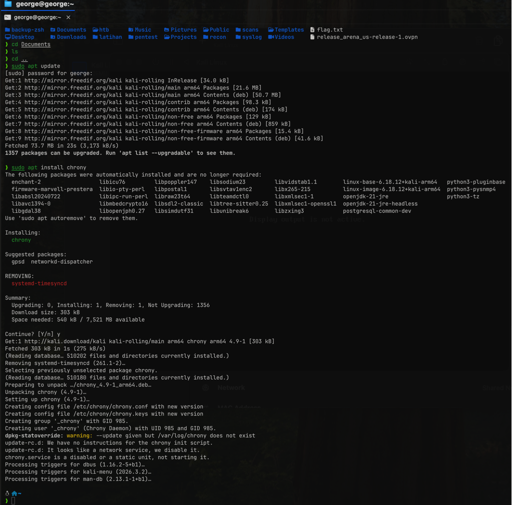
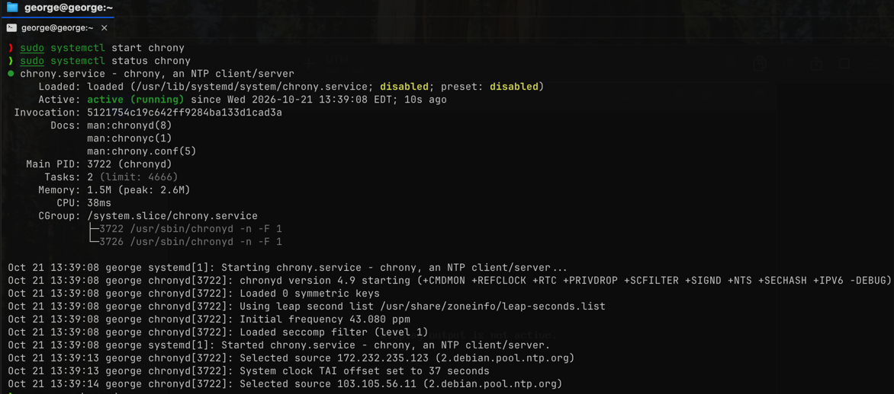
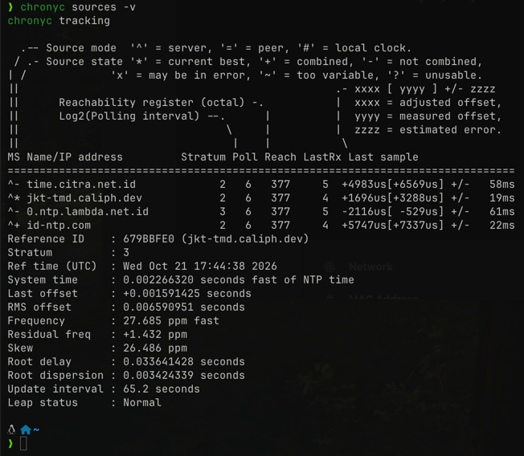
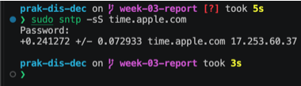
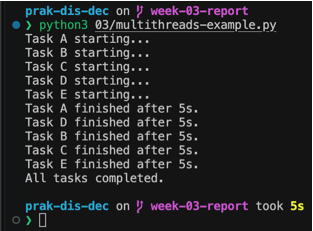
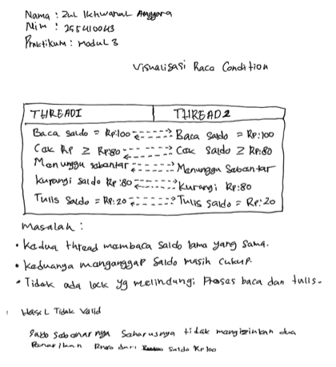
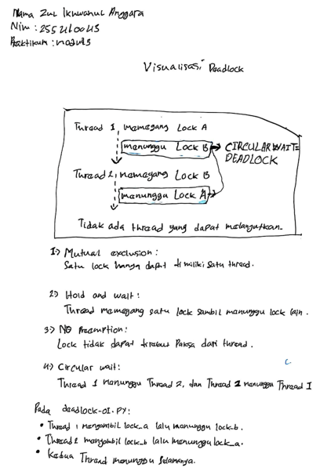
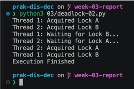
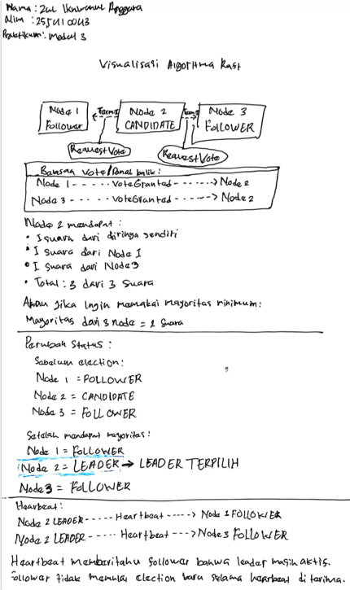

# Laporan Praktikum Sistem Terdistribusi dan Terdesentralisasi

## Pertemuan 03: Sinkronisasi pada Sistem Terdistribusi

### Identitas

* Nama: **Zul Ikhwanul Anggara**
* NIM: **255410043**
* Kelas: **Informatika-1**
* Tanggal Praktikum: **14 Oktober 2026**

## 1. Tujuan

1. Memahami sinkronisasi waktu dan event pada sistem terdistribusi.
2. Menganalisis vector clock, race condition, deadlock, serta pemilihan leader Raft.
3. Membuat modul Python yang dapat digunakan kembali.

## 2. Dasar Teori

Sinkronisasi waktu menyamakan waktu antarperangkat menggunakan NTP. Vector clock memberi urutan kausal event tanpa bergantung pada jam fisik. Race condition terjadi ketika beberapa thread mengakses data bersama dengan urutan yang tidak terkendali. Deadlock terjadi ketika thread saling menunggu lock. Raft mencapai konsensus melalui pemilihan candidate menjadi leader berdasarkan mayoritas suara.

## 3. Alat dan Bahan

* macOS/Linux
* Python 3
* Chrony atau layanan NTP
* Source code pada direktori ini

## 4. Langkah Pengerjaan

### 4.1 Sinkronisasi waktu menggunakan Chrony

Praktikum utama dilakukan pada Kali Linux ARM64 di Linux VM. Chrony berfungsi sebagai client NTP yang menghubungi server waktu, mengukur offset, lalu menyesuaikan waktu sistem.

Instalasi dilakukan dengan:

```bash
sudo apt update
sudo apt install chrony
```



Setelah instalasi, service diperiksa dan dijalankan:

```bash
sudo systemctl status chrony
sudo systemctl start chrony
```

Pada percobaan awal, service berstatus `inactive (dead)`. Kondisi tersebut menyebabkan `chronyc` menampilkan `506 Cannot talk to daemon`. Setelah `chrony` dijalankan, status service menjadi aktif dan daemon dapat menerima permintaan dari client `chronyc`.

```bash
chronyc sources -v
chronyc tracking
```

 

`chronyc sources -v` menampilkan server NTP yang tersedia dan sumber yang dipilih. `chronyc tracking` menampilkan reference time, stratum, system time, offset, serta status leap. Data tersebut menjadi bukti bahwa Chrony telah berjalan dan melakukan sinkronisasi waktu.

Sebagai pengujian tambahan pada macOS, sinkronisasi NTP juga dilakukan menggunakan client bawaan macOS:

```bash
sntp -sS time.apple.com
```



### 4.2 Menjalankan program contoh

```bash
python3 03/vclocks.py
python3 03/multithreads-example.py
python3 03/race-conditions-01.py
python3 03/race-conditions-02.py
python3 03/deadlock-01.py
python3 03/deadlock-02.py
python3 03/raft.py
```

`deadlock-01.py` dapat berhenti menunggu tanpa batas. Hentikan dengan `Ctrl+C` setelah kondisi deadlock terlihat.

### 4.3 Modul yang dibuat

```bash
python3 03/vector_clock.py
python3 03/raft_module.py
```

`vector_clock.py` menyediakan `increment`, `send`, `receive`, `happens_before`, dan `concurrent_with`. `raft_module.py` menyediakan `RaftCluster`, pemilihan leader, serta penambahan entry.

## 5. Hasil Praktikum

### 5.1 Vector clock

Setiap event lokal menaikkan elemen clock milik proses. Saat mengirim pesan, proses menaikkan clock sebelum mengirim. Saat menerima pesan, proses mengambil nilai maksimum tiap elemen, lalu menaikkan clock lokal. Jika seluruh elemen clock A tidak lebih besar dari B dan minimal satu lebih kecil, A terjadi sebelum B. Jika kedua kondisi arah tidak terpenuhi, event bersifat concurrent.

### 5.2 Multithreading

Kelima thread dimulai hampir bersamaan. Karena scheduler OS menentukan giliran eksekusi, urutan pesan `starting` dan `finished` tidak harus sama pada setiap eksekusi. Semua task tetap selesai karena setiap thread dipanggil `join()`.

 

### 5.3 Race condition

Pada `race-conditions-01.py`, dua thread sama-sama membaca saldo Rp100 sebelum salah satunya mengurangi saldo. Keduanya dapat lolos pemeriksaan saldo dan melakukan penarikan Rp80, sehingga hasil akhir dapat menjadi negatif atau menunjukkan dua transaksi yang tidak valid.

Pada `race-conditions-02.py`, `Lock` membuat pemeriksaan dan pengurangan saldo menjadi satu critical section. Thread kedua menunggu sampai thread pertama melepas lock, lalu membaca saldo terbaru. Karena saldo tersisa Rp20, penarikan kedua tidak dilakukan.

Visualisasi manual:

1. Saldo awal adalah Rp100.
2. Thread 1 membaca saldo Rp100 dan memeriksa bahwa Rp100 >= Rp80.
3. Sebelum Thread 1 mengurangi saldo, Thread 2 juga membaca saldo Rp100 dan lolos pemeriksaan.
4. Kedua thread melakukan penarikan Rp80 tanpa sinkronisasi.
5. Pemeriksaan saldo dan pengurangan tidak dilakukan sebagai satu operasi atomik.

Akibatnya, dua transaksi dapat sama-sama dianggap valid walaupun total penarikan Rp160 melebihi saldo awal. Inilah data race: hasil bergantung pada urutan eksekusi thread.



 

### 5.4 Deadlock

`deadlock-01.py` memiliki circular wait: Thread 1 memegang Lock A dan menunggu Lock B, sedangkan Thread 2 memegang Lock B dan menunggu Lock A. Tidak ada thread yang dapat melanjutkan.

`deadlock-02.py` melepaskan lock pertama sebelum mengambil lock kedua dan menggunakan timeout. Karena tidak ada thread yang memegang satu lock sambil menunggu lock lainnya, circular wait tidak terbentuk.

Visualisasi manual:

1. Thread 1 memperoleh `lock_a`, kemudian menunggu `lock_b`.
2. Thread 2 memperoleh `lock_b`, kemudian menunggu `lock_a`.
3. Thread 1 tidak dapat melanjutkan karena `lock_b` dimiliki Thread 2.
4. Thread 2 tidak dapat melanjutkan karena `lock_a` dimiliki Thread 1.
5. Terbentuk circular wait sehingga kedua thread berhenti menunggu.



 

### 5.5 Raft

Node memulai sebagai follower. Saat timeout terjadi, node menjadi candidate, menaikkan term, dan meminta suara. Candidate yang memperoleh mayoritas menjadi leader. Leader mengirim heartbeat agar follower tidak memulai election baru. Modul `raft_module.py` menyederhanakan proses tersebut menjadi pemilihan leader dan penambahan log.

Visualisasi manual:

1. Semua node mulai sebagai follower.
2. Setelah election timeout, Node 2 menjadi candidate dan menaikkan term.
3. Node 2 mengirim `RequestVote` kepada Node 1 dan Node 3.
4. Node 2 memperoleh suara mayoritas, yaitu minimal 2 dari 3 suara termasuk suara sendiri.
5. Node 2 berubah menjadi leader dan mengirim heartbeat kepada follower.
6. Selama heartbeat diterima, follower tidak memulai election baru.




## 5.6 Output modul buatan

 

## 6. Analisis

Sinkronisasi diperlukan agar event dan akses data dapat dikoordinasikan. Vector clock menyelesaikan kebutuhan urutan kausal, bukan menyamakan jam fisik. Lock mencegah race condition, tetapi penggunaan lock yang salah dapat menghasilkan deadlock. Raft menggunakan timeout, term, vote, dan mayoritas untuk memilih satu koordinator secara terdistribusi.

## 7. Kendala dan Solusi

| Kendala                                        | Solusi                                                            |
| ---------------------------------------------- | ----------------------------------------------------------------- |
| Output thread dapat berubah                    | Menjalankan program beberapa kali dan menjelaskan peran scheduler |
| `deadlock-01.py` berhenti                      | Menghentikan proses dengan `Ctrl+C` setelah deadlock teramati     |
| Tidak tersedia source screenshot dari eksekusi | Menambahkan screenshot hasil eksekusi secara manual pada laporan  |

## 8. Kesimpulan

Praktikum menunjukkan bahwa sistem terdistribusi tidak boleh diasumsikan berjalan berurutan. Vector clock membantu menentukan hubungan kausal, lock mengendalikan akses data bersama, aturan lock mencegah deadlock, dan Raft memilih leader menggunakan mekanisme voting mayoritas.

## 9. Referensi

1. Modul 3 Praktikum Sistem Terdistribusi dan Terdesentralisasi, Universitas Teknologi Digital Indonesia.
2. Python Documentation — `threading`: https://docs.python.org/3/library/threading.html
3. Chrony Documentation: https://chrony-project.org/
