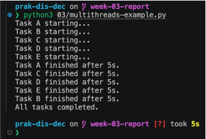
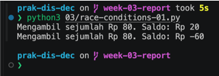
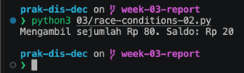
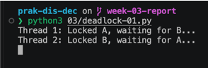
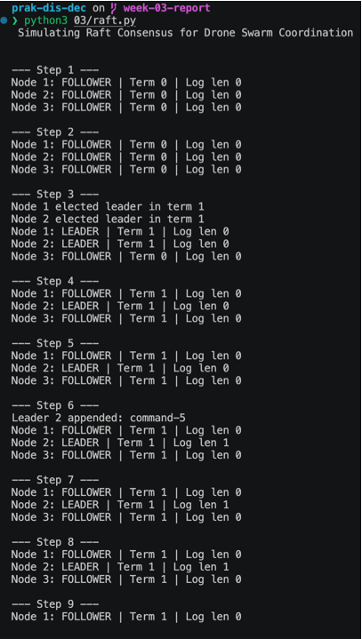
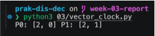
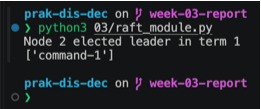

# Laporan Praktikum Sistem Terdistribusi dan Terdesentralisasi

## Pertemuan 03: Sinkronisasi pada Sistem Terdistribusi

### Identitas
- Nama: **Zul Ikhwanul Anggara**
- NIM: **255410043**
- Kelas: **Informatika-1**
- Tanggal Praktikum: **14 Oktober 2026**

## 1. Tujuan

1. Memahami sinkronisasi waktu dan event pada sistem terdistribusi.
2. Menganalisis vector clock, race condition, deadlock, serta pemilihan leader Raft.
3. Membuat modul Python yang dapat digunakan kembali.

## 2. Dasar Teori

Sinkronisasi waktu menyamakan waktu antarperangkat menggunakan NTP. Vector clock memberi urutan kausal event tanpa bergantung pada jam fisik. Race condition terjadi ketika beberapa thread mengakses data bersama dengan urutan yang tidak terkendali. Deadlock terjadi ketika thread saling menunggu lock. Raft mencapai konsensus melalui pemilihan candidate menjadi leader berdasarkan mayoritas suara.

## 3. Alat dan Bahan

- macOS/Linux
- Python 3
- Chrony atau layanan NTP
- Source code pada direktori ini

## 4. Langkah Pengerjaan

### 4.1 Sinkronisasi waktu

Sinkronisasi NTP memerlukan client waktu yang menghubungi server NTP, mengukur selisih waktu, lalu menyesuaikan jam sistem secara bertahap. Pada macOS, status waktu dapat diperiksa dengan:

```bash
sntp -sS time.apple.com
```

### 4.2 Menjalankan program contoh

```bash
python3 03/vclocks.py
python3 03/multithreads-example.py
python3 03/race-conditions-01.py
python3 03/race-conditions-02.py
python3 03/deadlock-01.py
python3 03/deadlock-02.py
python3 03/raft.py
```

`deadlock-01.py` dapat berhenti menunggu tanpa batas. Hentikan dengan `Ctrl+C` setelah kondisi deadlock terlihat.

### 4.3 Modul yang dibuat

```bash
python3 03/vector_clock.py
python3 03/raft_module.py
```

`vector_clock.py` menyediakan `increment`, `send`, `receive`, `happens_before`, dan `concurrent_with`. `raft_module.py` menyediakan `RaftCluster`, pemilihan leader, serta penambahan entry.

## 5. Hasil Praktikum

### 5.1 Vector clock

Setiap event lokal menaikkan elemen clock milik proses. Saat mengirim pesan, proses menaikkan clock sebelum mengirim. Saat menerima pesan, proses mengambil nilai maksimum tiap elemen, lalu menaikkan clock lokal. Jika seluruh elemen clock A tidak lebih besar dari B dan minimal satu lebih kecil, A terjadi sebelum B. Jika kedua kondisi arah tidak terpenuhi, event bersifat concurrent.

### 5.2 Multithreading

Kelima thread dimulai hampir bersamaan. Karena scheduler OS menentukan giliran eksekusi, urutan pesan `starting` dan `finished` tidak harus sama pada setiap eksekusi. Semua task tetap selesai karena setiap thread dipanggil `join()`.




### 5.3 Race condition

Pada `race-conditions-01.py`, dua thread sama-sama membaca saldo Rp100 sebelum salah satunya mengurangi saldo. Keduanya dapat lolos pemeriksaan saldo dan melakukan penarikan Rp80, sehingga hasil akhir dapat menjadi negatif atau menunjukkan dua transaksi yang tidak valid.

Pada `race-conditions-02.py`, `Lock` membuat pemeriksaan dan pengurangan saldo menjadi satu critical section. Thread kedua menunggu sampai thread pertama melepas lock, lalu membaca saldo terbaru. Karena saldo tersisa Rp20, penarikan kedua tidak dilakukan.

Visualisasi yang perlu dilampirkan: dua thread membaca saldo Rp100 pada waktu yang sama, kemudian masing-masing menulis hasil pengurangan.




### 5.4 Deadlock

`deadlock-01.py` memiliki circular wait: Thread 1 memegang Lock A dan menunggu Lock B, sedangkan Thread 2 memegang Lock B dan menunggu Lock A. Tidak ada thread yang dapat melanjutkan.

`deadlock-02.py` melepaskan lock pertama sebelum mengambil lock kedua dan menggunakan timeout. Karena tidak ada thread yang memegang satu lock sambil menunggu lock lainnya, circular wait tidak terbentuk.

Visualisasi yang perlu dilampirkan: T1: A → menunggu B; T2: B → menunggu A.




### 5.5 Raft

Node memulai sebagai follower. Saat timeout terjadi, node menjadi candidate, menaikkan term, dan meminta suara. Candidate yang memperoleh mayoritas menjadi leader. Leader mengirim heartbeat agar follower tidak memulai election baru. Modul `raft_module.py` menyederhanakan proses tersebut menjadi pemilihan leader dan penambahan log.

Visualisasi yang perlu dilampirkan: tiga node, candidate mengirim request vote, dua dari tiga suara memilih candidate, kemudian candidate menjadi leader.



## 5.6 Output modul buatan




## 6. Analisis

Sinkronisasi diperlukan agar event dan akses data dapat dikoordinasikan. Vector clock menyelesaikan kebutuhan urutan kausal, bukan menyamakan jam fisik. Lock mencegah race condition, tetapi penggunaan lock yang salah dapat menghasilkan deadlock. Raft menggunakan timeout, term, vote, dan mayoritas untuk memilih satu koordinator secara terdistribusi.

## 7. Kendala dan Solusi

| Kendala | Solusi |
|---|---|
| Output thread dapat berubah | Menjalankan program beberapa kali dan menjelaskan peran scheduler |
| `deadlock-01.py` berhenti | Menghentikan proses dengan `Ctrl+C` setelah deadlock teramati |
| Tidak tersedia source screenshot dari eksekusi | Menambahkan screenshot hasil eksekusi secara manual pada laporan |

## 8. Kesimpulan

Praktikum menunjukkan bahwa sistem terdistribusi tidak boleh diasumsikan berjalan berurutan. Vector clock membantu menentukan hubungan kausal, lock mengendalikan akses data bersama, aturan lock mencegah deadlock, dan Raft memilih leader menggunakan mekanisme voting mayoritas.

## 9. Referensi

1. Modul 3 Praktikum Sistem Terdistribusi dan Terdesentralisasi, Universitas Teknologi Digital Indonesia.
2. Python Documentation — `threading`: https://docs.python.org/3/library/threading.html
3. Chrony Documentation: https://chrony-project.org/
