# Laporan Praktikum Sistem Terdistribusi dan Terdesentralisasi

## Pertemuan 04: Konsistensi dan Replikasi

### Identitas

* Nama: **Zul Ikhwanul Anggara**
* NIM: **255410043**
* Kelas: **Informatika-1**
* Tanggal Praktikum: **21 Oktober 2026**

## 1. Tujuan

Praktikum ini bertujuan untuk:

1. Mengonfigurasi streaming replication PostgreSQL dengan satu server primary dan satu server replica.
2. Membuktikan bahwa perubahan data pada primary diteruskan ke replica.
3. Mencoba promosi replica ketika primary dihentikan sebagai simulasi high availability.
4. Menjalankan cluster Apache Ignite dan mengamati replikasi master-master pada beberapa node.

## 2. Dasar Teori

Replikasi adalah proses menyalin data dari satu server ke server lain. Pada streaming replication PostgreSQL, primary mencatat perubahan ke Write-Ahead Log (WAL). Replica menerima aliran WAL tersebut dan menerapkannya pada salinan basis datanya. Primary menangani operasi baca-tulis, sedangkan replica pada kondisi normal berada dalam mode siaga dan melayani pembacaan.

Status primary dapat diperiksa melalui `pg_is_in_recovery()`. Nilai `false` menunjukkan server primary, sedangkan `true` menunjukkan server standby. Informasi koneksi replica dapat dilihat melalui `pg_stat_replication` pada primary.

High availability dapat dicapai dengan mempromosikan replica menjadi primary ketika primary mengalami gangguan. Promosi ini membuat replica keluar dari mode recovery dan dapat menerima operasi tulis.

Apache Ignite menggunakan cluster dengan beberapa node. Pada praktikum ini, node-node Ignite diinisialisasi dalam satu cluster sehingga struktur dan data yang dibuat melalui satu node dapat diakses dari node lain. Model ini berbeda dari PostgreSQL primary-replica karena node Ignite dapat berperan sebagai node yang menerima operasi pada cluster.

## 3. Alat dan Bahan

* macOS
* Docker Desktop
* Docker Compose V2
* PostgreSQL 18.3 Alpine
* Apache Ignite 3.1.0
* Terminal
* Source code pada direktori `04/postgres` dan `04/ignite`

Praktikum dijalankan pada macOS menggunakan Docker Desktop. Karena itu, perintah yang digunakan adalah `docker compose`, tanpa `sudo`. Untuk koneksi dari container CLI ke layanan Docker Desktop, digunakan `host.docker.internal`.

## 4. Langkah Pengerjaan

### 4.1 Pemeriksaan Docker

Docker Desktop dijalankan terlebih dahulu. Instalasi kemudian diperiksa melalui `docker --version`, `docker compose version`, dan `docker info`. Perintah `hello-world` digunakan untuk memastikan daemon Docker dapat menjalankan container.

```bash
docker --version
docker compose version
docker info
docker run --rm hello-world
```

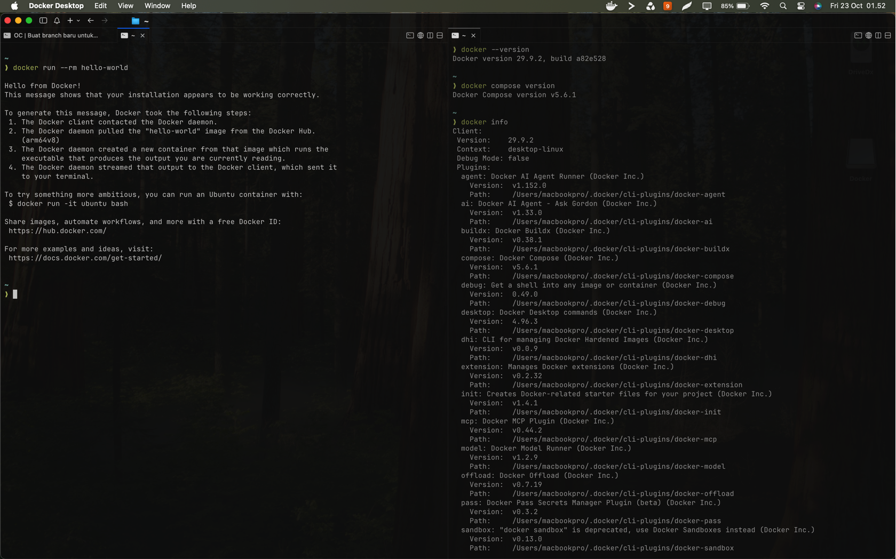

### 4.2 Persiapan berkas PostgreSQL

Berkas PostgreSQL diletakkan di `04/postgres`, yaitu `00_init.sql`, `docker-compose.yaml`, dan `env.sh`. Berkas `00_init.sql` membuat user replikasi dan replication slot. File Compose mendefinisikan service `postgres_primary` dan `postgres_replica`.

Konfigurasi diperiksa sebelum container dijalankan:

```bash
cd 04/postgres
docker compose config
```

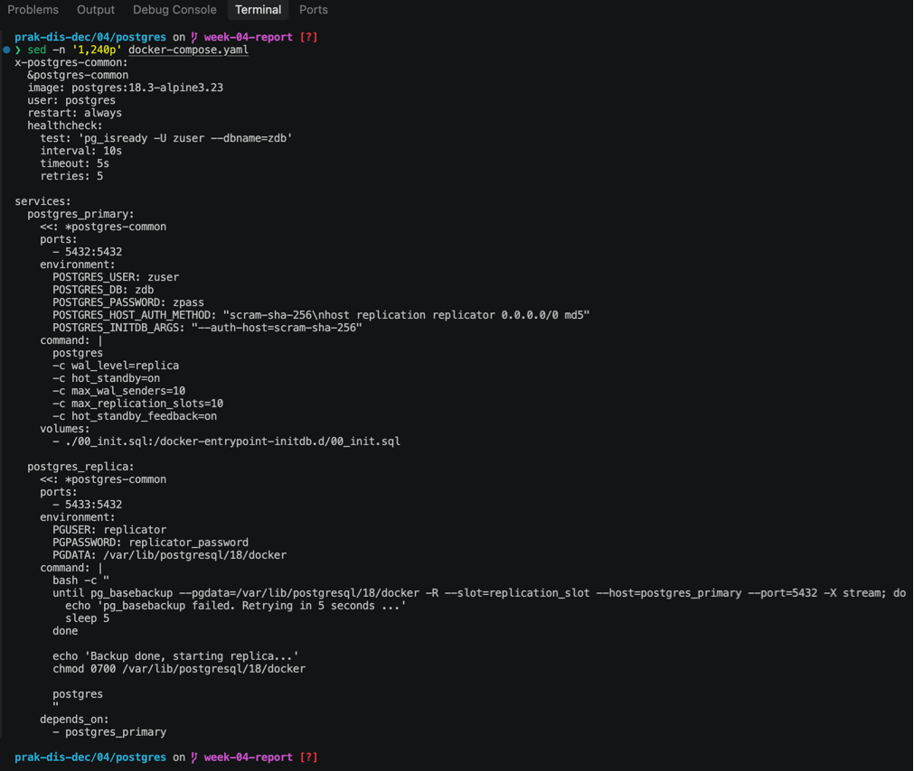

### 4.3 Menjalankan PostgreSQL

Kedua service dijalankan menggunakan Docker Compose.

```bash
docker compose up -d
docker compose ps
```

Primary menggunakan port `5432`, sedangkan replica menggunakan port `5433`. Replica mengambil salinan awal data melalui `pg_basebackup`, kemudian melanjutkan penerimaan WAL dari primary.

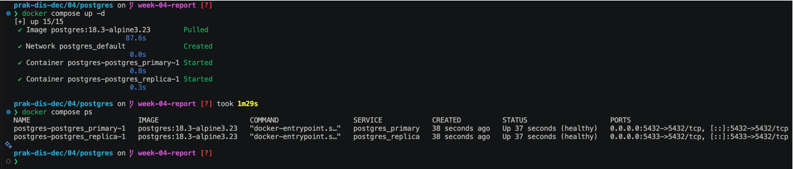

### 4.4 Pemeriksaan primary

Status primary diperiksa dengan perintah berikut:

```bash
docker compose exec postgres_primary \
  psql -U zuser -d zdb \
  -c "SELECT pg_is_in_recovery();"
```

Hasil `f` menunjukkan bahwa server bukan berada dalam mode recovery. Koneksi replica kemudian diperiksa melalui `pg_stat_replication`.

```bash
docker compose exec postgres_primary \
  psql -U zuser -d zdb \
  -c "SELECT client_addr, usename, state, sync_state FROM pg_stat_replication;"
```

Nilai `streaming` pada kolom `state` menunjukkan bahwa aliran perubahan dari primary ke replica sedang berlangsung.

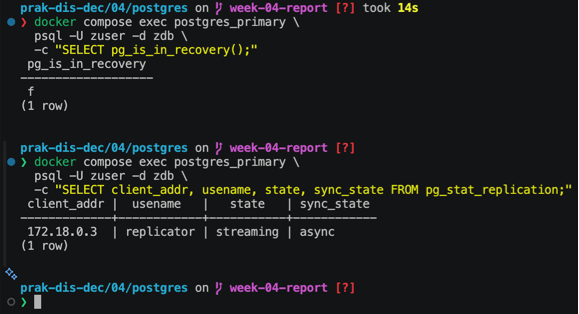

### 4.5 Pemeriksaan replica

Status replica diperiksa dengan:

```bash
docker compose exec postgres_replica \
  psql -U replicator -d zdb \
  -c "SELECT pg_is_in_recovery();"
```

Hasil `t` menunjukkan bahwa server masih berada dalam mode recovery dan berfungsi sebagai replica.

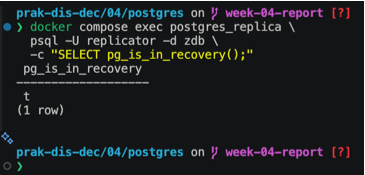

### 4.6 Pengujian replikasi data

Sebuah tabel dibuat pada primary, kemudian diisi dengan data.

```sql
CREATE TABLE praktikum (
    id SERIAL PRIMARY KEY,
    keterangan TEXT NOT NULL
);

INSERT INTO praktikum (keterangan)
VALUES ('Data dari primary');

SELECT * FROM praktikum;
```

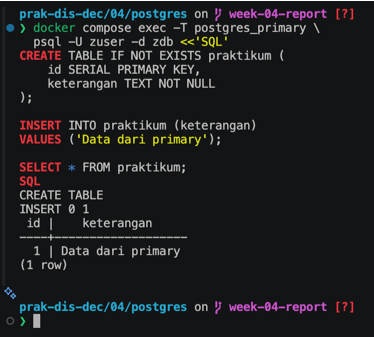

Data kemudian diperiksa pada replica menggunakan:

```bash
docker compose exec postgres_replica \
  psql -U replicator -d zdb \
  -c "SELECT * FROM praktikum;"
```

Data yang muncul pada replica sama dengan data pada primary. Hal ini menunjukkan bahwa perubahan telah direplikasi melalui WAL.

### 4.7 Pengujian high availability

Primary dihentikan untuk mensimulasikan gangguan server:

```bash
docker compose stop postgres_primary
docker compose ps
```

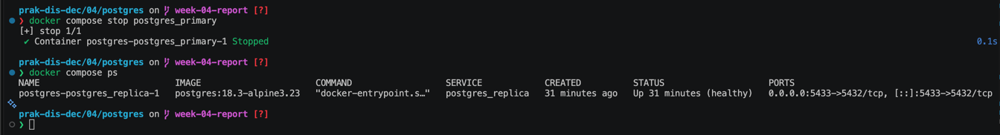

Replica kemudian dipromosikan menjadi primary:

```bash
docker compose exec postgres_replica \
  pg_ctl -D /var/lib/postgresql/18/docker promote
```

Status recovery diperiksa kembali:

```bash
docker compose exec postgres_replica \
  psql -U replicator -d zdb \
  -c "SELECT pg_is_in_recovery();"
```

Hasil berubah menjadi `f`. Artinya, replica sudah keluar dari mode recovery dan berhasil dipromosikan menjadi primary baru.

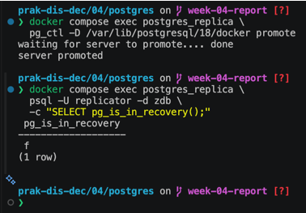

Setelah pengujian selesai, container PostgreSQL dihentikan:

```bash
docker compose down
```

### 4.8 Persiapan Apache Ignite

Berkas Apache Ignite diletakkan di `04/ignite`. Selain file Compose dan `env.sh`, tersedia folder `sql` yang berisi file pembentukan skema dan pengisian data.

Konfigurasi diperiksa dengan:

```bash
cd ../ignite
docker compose config
```

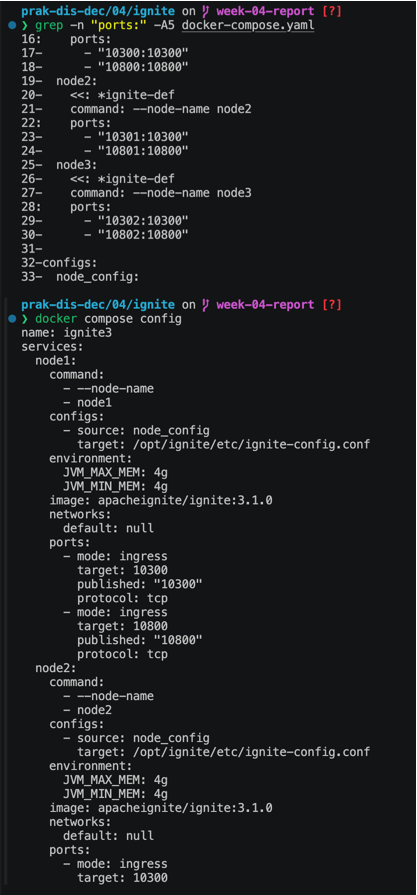

### 4.9 Menjalankan tiga node Ignite

Tiga node Apache Ignite dijalankan secara bersamaan:

```bash
docker compose up -d
docker compose ps
```

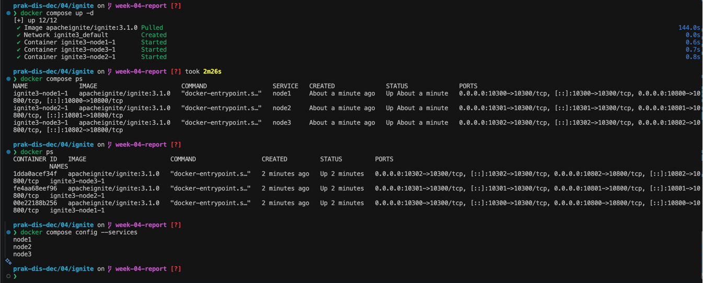

Pada macOS, port REST tiap node diakses melalui `localhost` atau `host.docker.internal`. Port yang digunakan adalah `10300`, `10301`, dan `10302`.

### 4.10 Inisialisasi cluster Ignite

CLI Apache Ignite 3.1.0 tidak menerima opsi `--url` secara langsung. Oleh karena itu, CLI dijalankan terlebih dahulu, kemudian koneksi dilakukan menggunakan perintah `connect`.

```bash
docker run --rm -it \
  -e LANG=C.UTF-8 \
  -e LC_ALL=C.UTF-8 \
  apacheignite/ignite:3.1.0 cli
```

Di dalam CLI:

```
connect http://host.docker.internal:10300
cluster init --name=ignite3 --metastorage-group=node1,node2,node3
```

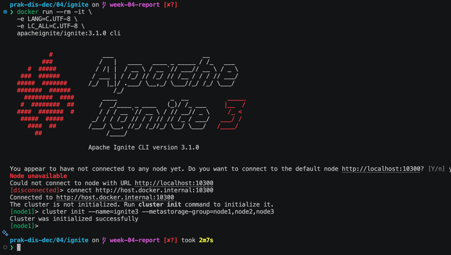

### 4.11 Eksekusi SQL Ignite

Folder SQL dipasang ke dalam container CLI agar file SQL dapat dibaca dari dalam container.

```bash
docker run --rm -it \
  -e LANG=C.UTF-8 \
  -e LC_ALL=C.UTF-8 \
  -v "$PWD/sql:/opt/ignite/sql" \
  apacheignite/ignite:3.1.0 cli
```

Setelah terhubung ke node, mode SQL digunakan untuk memeriksa tabel dan menjalankan file SQL. Tabel yang dihasilkan kemudian diperiksa melalui `SYSTEM.TABLES`.

```sql
SELECT * FROM system.tables WHERE schema = 'PUBLIC';
```

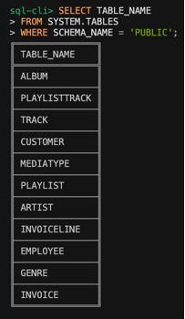

Query analitik penjualan juga dijalankan untuk melihat jumlah faktur, jumlah pelanggan, pendapatan bulanan, dan rata-rata nilai pesanan.

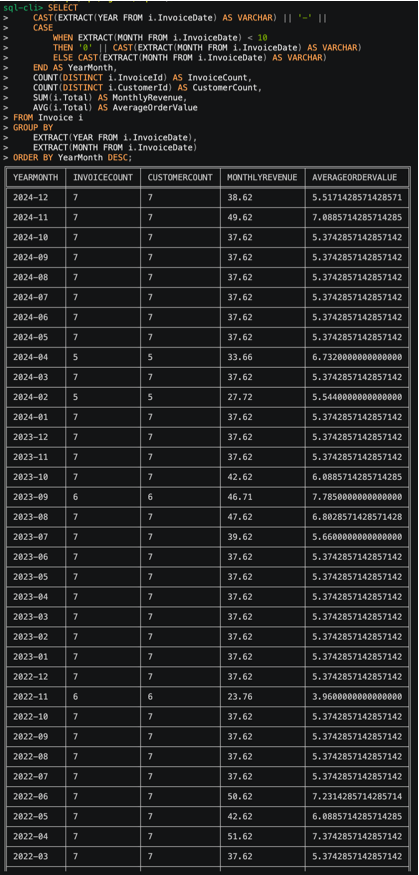

### 4.12 Pemeriksaan replikasi pada tiga node

Koneksi ke node dilakukan melalui port masing-masing:

```
http://host.docker.internal:10300
http://host.docker.internal:10301
http://host.docker.internal:10302
```

Pada setiap node dijalankan query:

```sql
SELECT * FROM system.tables WHERE schema = 'PUBLIC';
```

Hasil pemeriksaan:

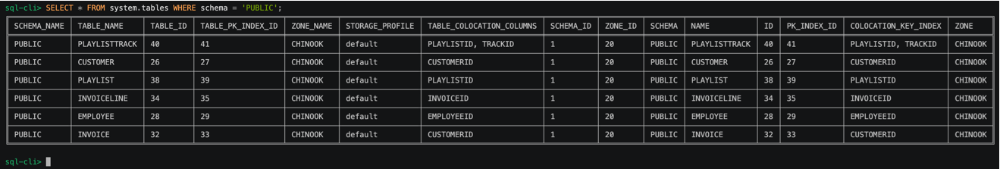 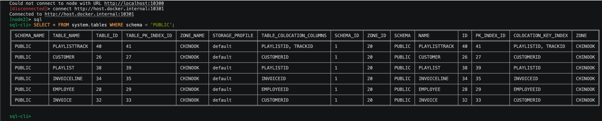 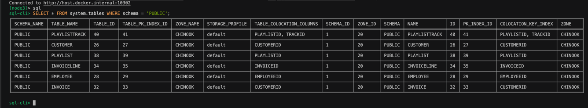

Alamat IP container juga diperiksa menggunakan `docker inspect`:

```bash
docker inspect -f \
'{{range .NetworkSettings.Networks}}{{.IPAddress}}{{end}}' \
<NAMA_CONTAINER>
```

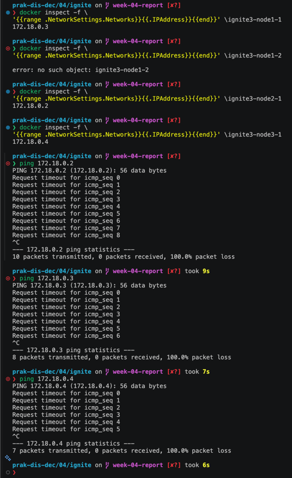

Setelah pengujian selesai, semua node dihentikan:

```bash
docker compose down
```

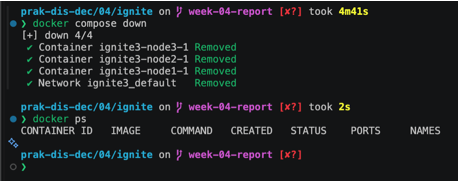

## 5. Hasil Praktikum

Hasil praktikum menunjukkan bahwa PostgreSQL primary dan replica berhasil dijalankan dalam dua container. Primary dapat diketahui dari hasil `pg_is_in_recovery()` bernilai `f`, sedangkan replica menghasilkan `t`. Perubahan data yang dibuat pada primary dapat dibaca dari replica.

Saat primary dihentikan, replica berhasil dipromosikan menjadi primary. Perubahan nilai `pg_is_in_recovery()` dari `t` menjadi `f` menjadi indikator bahwa proses promosi berhasil.

Pada Apache Ignite, tiga node berhasil dijalankan dan diinisialisasi sebagai satu cluster. File SQL berhasil digunakan untuk membentuk tabel dan menjalankan query analitik. Pemeriksaan pada node-node Ignite menunjukkan bahwa struktur data tersedia pada cluster.

## 6. Analisis

Streaming replication PostgreSQL menggunakan pendekatan primary-standby. Hanya primary yang menerima perubahan data, sedangkan replica menerima salinan perubahan melalui WAL. Pendekatan ini menjaga konsistensi data antara dua server, tetapi replica tidak langsung dapat menerima penulisan sebelum dipromosikan.

Pengujian replikasi membuktikan bahwa data tidak perlu dibuat ulang secara manual pada replica. Setelah transaksi pada primary selesai, data yang sama tersedia pada replica. Dengan demikian, replica dapat digunakan sebagai salinan cadangan dan sumber pembacaan.

Promosi replica menunjukkan konsep high availability. Ketika primary tidak tersedia, replica dapat mengambil alih peran primary. Dalam sistem nyata, proses ini biasanya dilengkapi pemantauan otomatis, pemilihan kandidat, dan pengaturan ulang koneksi aplikasi.

Apache Ignite menggunakan beberapa node dalam satu cluster. Berbeda dari model PostgreSQL yang memisahkan primary dan standby, cluster Ignite menyediakan beberapa node yang bekerja bersama. Karena itu, perubahan struktur dan data dapat diamati dari node yang berbeda. Replikasi master-master mengurangi ketergantungan pada satu server, tetapi tetap memerlukan pengaturan cluster dan konsistensi yang tepat.

Penyesuaian pada macOS terutama berkaitan dengan penggunaan Docker Desktop, penggantian `docker-compose` menjadi `docker compose`, penghilangan `sudo`, serta penggunaan `host.docker.internal` untuk koneksi antarkontainer dan host Docker Desktop.

## 7. Kendala dan Solusi

| Kendala                                                                     | Solusi                                                                                                                       |
| --------------------------------------------------------------------------- | ---------------------------------------------------------------------------------------------------------------------------- |
| Petunjuk modul menggunakan Linux, sedangkan praktikum dilakukan pada macOS  | Menggunakan Docker Desktop dan menyesuaikan perintah menjadi `docker compose` tanpa `sudo`                                   |
| Nama folder sumber PostgreSQL mengandung spasi, yaitu `src 2`               | Menyalin berkas ke folder `04/postgres` agar perintah lebih mudah dibaca dan dijalankan                                      |
| Replica PostgreSQL belum langsung berstatus sehat                           | Memeriksa log dengan `docker compose logs` dan menunggu proses `pg_basebackup` selesai                                       |
| Replica tidak dapat digunakan untuk menulis data                            | Menjalankan operasi tulis pada primary dan hanya membaca data dari replica                                                   |
| Opsi `--url` tidak dikenali oleh CLI Apache Ignite 3.1.0                    | Menjalankan CLI terlebih dahulu, lalu menggunakan perintah `connect` di dalam CLI                                            |
| Koneksi CLI Ignite dari container perlu mengakses Docker Desktop pada macOS | Menggunakan alamat `host.docker.internal` dan port node yang diteruskan                                                      |
| Tidak semua perintah Linux pada modul dapat digunakan langsung di macOS     | Menyesuaikan perintah berdasarkan Docker Desktop dan memeriksa hasil melalui `docker compose ps` serta `docker compose logs` |

## 8. Kesimpulan

Praktikum ini berhasil menunjukkan dua model replikasi pada sistem terdistribusi. PostgreSQL berhasil dikonfigurasi dengan satu primary dan satu replica. Data dari primary diteruskan ke replica, kemudian replica berhasil dipromosikan menjadi primary ketika primary dihentikan.

Apache Ignite berhasil dijalankan sebagai cluster tiga node. Cluster tersebut dapat diinisialisasi, menerima skema dan data SQL, serta menyediakan akses terhadap data dari beberapa node. Dari praktikum ini dapat dipahami bahwa replikasi membantu menjaga ketersediaan data dan mengurangi ketergantungan pada satu server, tetapi setiap model memiliki cara kerja dan batasan yang berbeda.

## 9. Referensi

1. Modul 4 Praktikum Sistem Terdistribusi dan Terdesentralisasi, Universitas Teknologi Digital Indonesia.
2. PostgreSQL Documentation — High Availability, Load Balancing, and Replication: https://www.postgresql.org/docs/current/high-availability.html
3. PostgreSQL Docker Image: https://hub.docker.com/\_/postgres
4. Apache Ignite 3 Documentation: https://ignite.apache.org/docs/ignite3/latest/
5. Docker Compose Documentation: https://docs.docker.com/compose/
