# Laporan Praktikum Sistem Terdistribusi dan Terdesentralisasi

## Pertemuan 05 — Fault Tolerance

### Identitas

- Nama: **Zul Ikhwanul Anggara**
- NIM: **255410043**
- Kelas: **Informatika-1**
- Tanggal praktikum: **30 Oktober 2026**

---

## 1. Tujuan

Praktikum ini bertujuan memahami penerapan fault tolerance pada aplikasi web sederhana. Implementasi dilakukan dengan menjalankan aplikasi Blacksheep dalam container Docker, menggandakan instance aplikasi, lalu menempatkan Nginx sebagai load balancer.

Selain load balancing, praktikum ini menguji tiga mekanisme yang umum dipakai ketika aplikasi bergantung pada service lain, yaitu heartbeat untuk mendeteksi kegagalan, retry untuk mengulangi koneksi yang gagal, dan circuit breaker untuk menghentikan sementara request menuju service yang sedang bermasalah.

---

## 2. Dasar Teori

### 2.1 Fault tolerance

Fault tolerance adalah kemampuan sistem untuk tetap menyediakan layanan ketika sebagian komponennya mengalami gangguan. Sistem tidak harus mencegah seluruh kegagalan, tetapi harus membatasi dampak kegagalan tersebut.

Pada aplikasi terdistribusi, kegagalan dapat terjadi karena container berhenti, service tidak merespons, koneksi jaringan terputus, atau proses aplikasi mengalami error. Karena itu, aplikasi biasanya dijalankan lebih dari satu instance dan dilengkapi mekanisme pemantauan serta pemulihan.

### 2.2 Load balancing

Load balancing membagi request yang masuk ke beberapa instance server. Dalam praktikum ini Nginx berperan sebagai reverse proxy. Client hanya mengakses Nginx pada port 80, sedangkan Nginx meneruskan request ke service `bs_app` pada jaringan internal Docker.

Dengan dua instance `bs_app`, beban tidak hanya ditangani oleh satu proses. Jika salah satu instance berhenti, instance lainnya masih memiliki kesempatan untuk melayani request.

### 2.3 Heartbeat dan failure detection

Heartbeat adalah pemeriksaan berkala terhadap service. Jika service memberikan response, service dianggap aktif. Jika koneksi gagal atau tidak memberikan response dalam batas waktu tertentu, service dianggap tidak tersedia.

Heartbeat tidak memperbaiki service yang gagal. Fungsinya adalah memberikan informasi status agar sistem atau operator dapat mengambil tindakan berikutnya.

### 2.4 Retry

Retry mengulangi request yang gagal. Mekanisme ini berguna untuk kegagalan sementara, misalnya service terlambat aktif atau koneksi sempat terputus. Retry harus memiliki batas percobaan dan jeda. Tanpa batas tersebut, aplikasi dapat terus menunggu service yang sebenarnya sudah tidak tersedia.

Library Tenacity digunakan untuk mengatur proses retry pada pengujian.

### 2.5 Circuit breaker

Circuit breaker mencegah kegagalan berantai. Circuit breaker memiliki tiga keadaan:

- `closed`: request diizinkan dan kegagalan dihitung;
- `open`: request ditolak sementara setelah jumlah kegagalan melewati batas;
- `half-open`: beberapa request percobaan diizinkan untuk memeriksa apakah service sudah pulih.

Jika pengujian pada keadaan `half-open` berhasil, circuit kembali ke `closed`. Jika gagal, circuit kembali ke `open`.

---

## 3. Alat dan Bahan

Praktikum dikerjakan pada macOS dengan perangkat lunak berikut:

- Python 3.13.16/3.14.x pada virtual environment;
- `uv` atau `pip` untuk instalasi package;
- Blacksheep;
- Uvicorn;
- Docker Desktop;
- Docker Compose;
- Nginx;
- Tenacity;
- Browser dan terminal.

Struktur utama project yang digunakan:

```text
05/
├── images/
└── workspace-05/
    ├── blacksheep_lb/
    │   ├── Dockerfile
    │   ├── requirements.txt
    │   └── app/
    ├── nginx/
    ├── docker-compose.yml
    └── env.sh
```

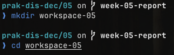

---

## 4. Langkah Pengerjaan

### 4.1 Menyiapkan workspace dan environment Python

Workspace dibuat sebagai tempat menyimpan aplikasi, konfigurasi Docker, dan script pengujian. Setelah itu virtual environment disiapkan agar dependency praktikum tidak bercampur dengan instalasi Python global.

```bash
mkdir -p workspace-05
cd workspace-05
uv venv
source .venv/bin/activate
python --version
```

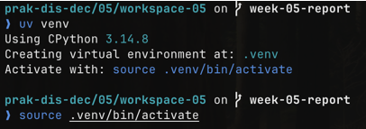

### 4.2 Menginstall Blacksheep

Package Blacksheep dan CLI-nya diinstall sebelum aplikasi dijalankan. Dependency aplikasi kemudian dipasang berdasarkan `requirements.txt`.

```bash
uv pip install blacksheep blacksheep-cli
uv pip install -r blacksheep_lb/requirements.txt
```

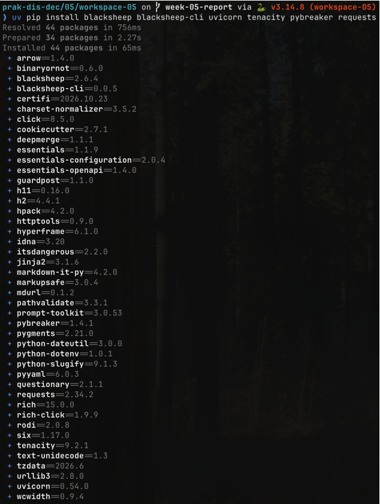

### 4.3 Menyiapkan aplikasi Blacksheep

Aplikasi yang digunakan merupakan aplikasi contoh Blacksheep. Aplikasi tidak dibuat untuk memproses data kompleks; fokusnya adalah menguji jalur request dari browser menuju Nginx dan kemudian menuju instance aplikasi.

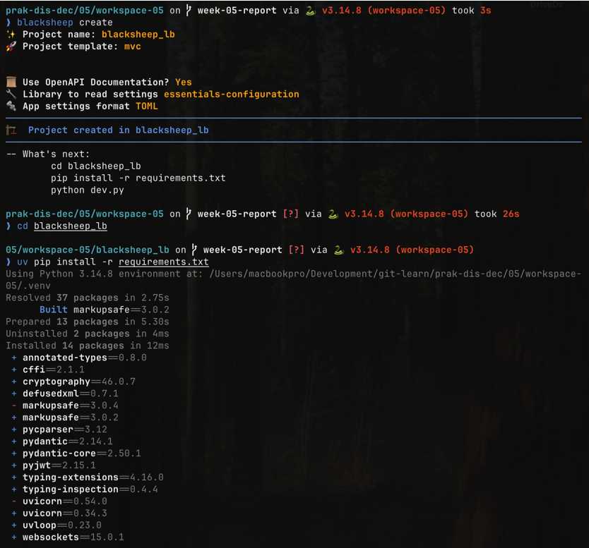

Aplikasi diuji terlebih dahulu tanpa Docker. Pada tahap ini port `44777` digunakan, sesuai instruksi modul untuk pengujian heartbeat, retry, dan circuit breaker.

```bash
cd blacksheep_lb
python -m uvicorn app.main:app --host 0.0.0.0 --port 44777
```

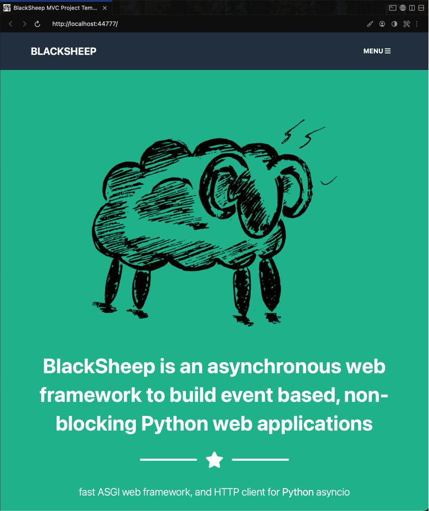

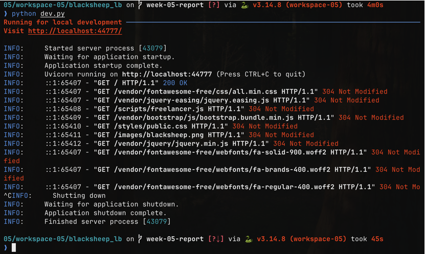

### 4.4 Membuat Dockerfile aplikasi

Dockerfile aplikasi menggunakan image Python slim. Dependency dipasang di tahap build, kemudian hasilnya disalin ke image runtime. Port `80` dibuka karena aplikasi akan menerima request dari Nginx melalui jaringan internal Docker.

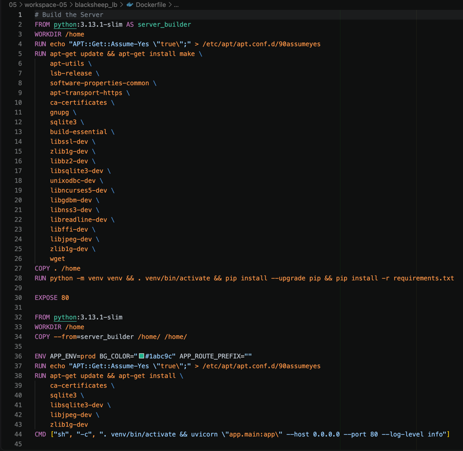

Image kemudian dibangun dan dijalankan secara langsung untuk memastikan aplikasi dapat berjalan di dalam container.

```bash
docker build -t praktikum-blacksheep ./blacksheep_lb
docker run --rm -p 44777:80 praktikum-blacksheep
```

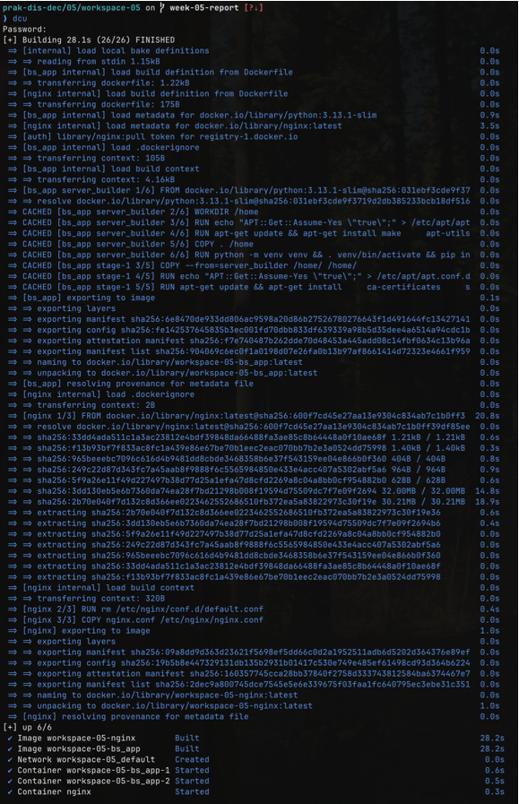

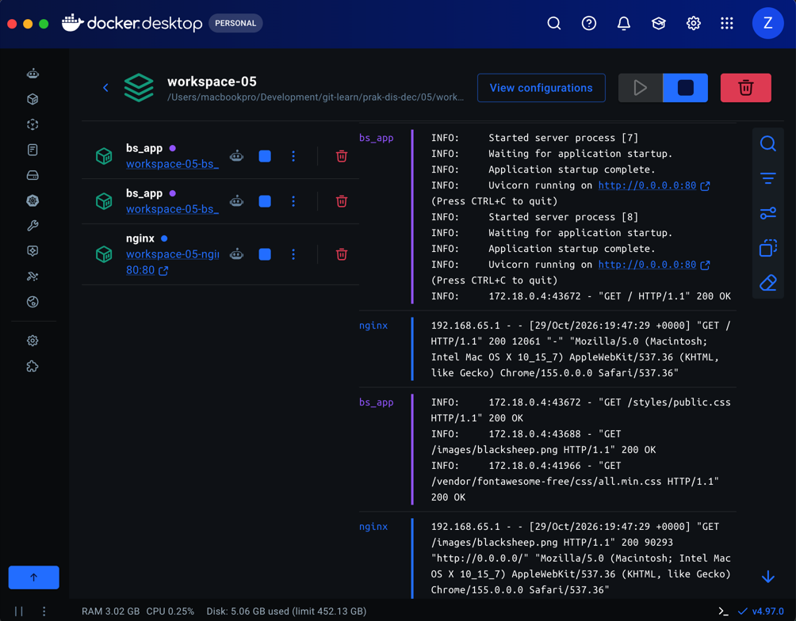

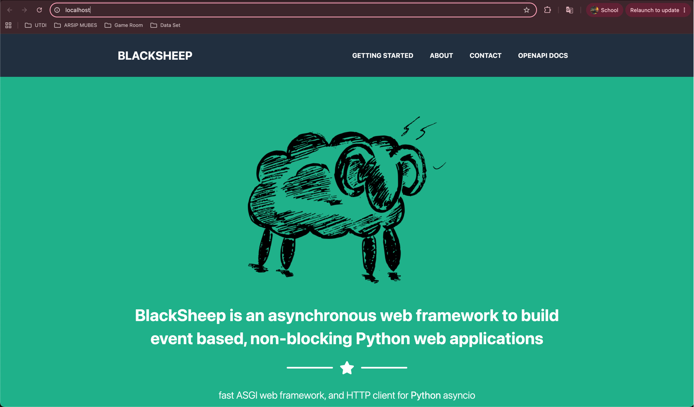

### 4.5 Membuat konfigurasi Nginx

Nginx digunakan sebagai service terpisah. Konfigurasi default Nginx dihapus kemudian diganti dengan konfigurasi yang mendefinisikan upstream `backend`.

```dockerfile
FROM nginx:latest

RUN rm /etc/nginx/conf.d/default.conf
COPY nginx.conf /etc/nginx/nginx.conf
```

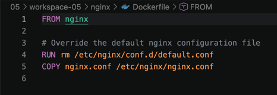

Konfigurasi upstream diarahkan ke service Docker bernama `bs_app` pada port internal `80`.

```nginx
events {
    worker_connections 4096;
}

http {
    upstream backend {
        server bs_app:80;
    }

    server {
        listen 80;

        location / {
            proxy_pass http://backend;
        }
    }
}
```

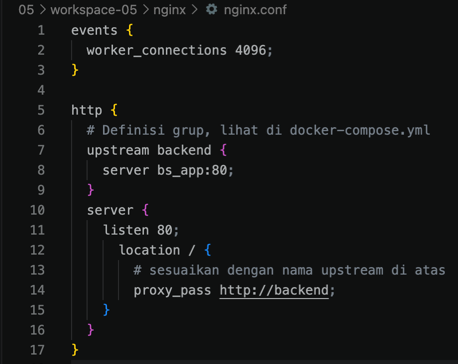

### 4.6 Membuat Docker Compose

File `docker-compose.yml` mendefinisikan dua service. `bs_app` dibangun dari direktori aplikasi, sedangkan `nginx` dibangun dari direktori konfigurasi Nginx. Hanya Nginx yang dipublikasikan ke host pada port 80.

```yaml
services:
  bs_app:
    build: ./blacksheep_lb

  nginx:
    container_name: nginx
    build: ./nginx
    ports:
      - "80:80"
    depends_on:
      - bs_app
```

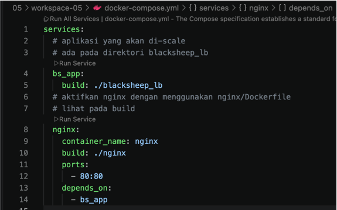

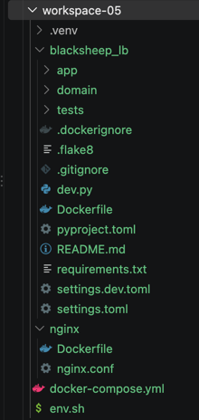

### 4.7 Menjalankan dua instance aplikasi

Docker Compose dijalankan menggunakan opsi `--scale` agar service `bs_app` memiliki dua instance.

```bash
docker compose up --build -d --scale bs_app=2
docker compose ps
```

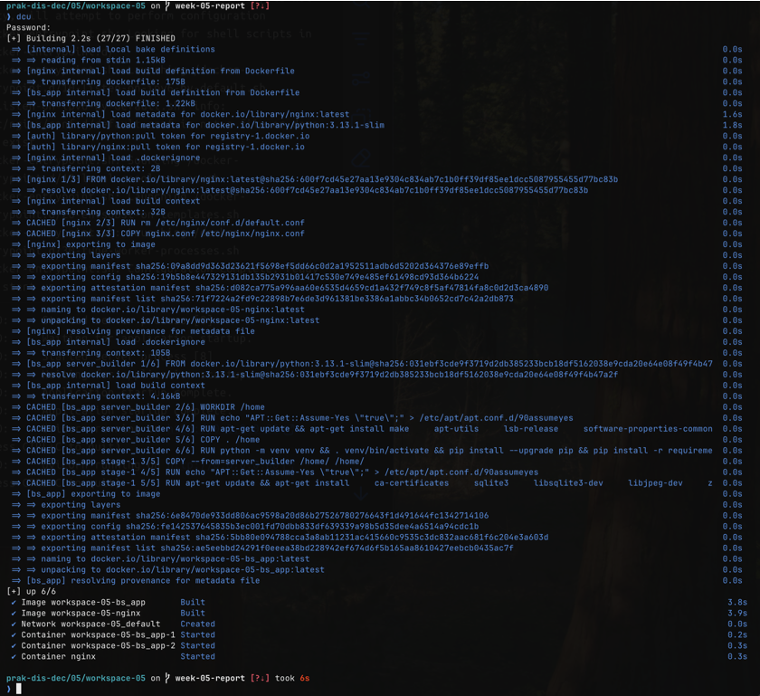

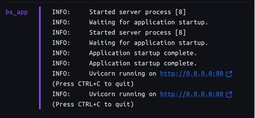

Dari hasil pemeriksaan container terlihat Nginx berjalan sebagai pintu masuk dan terdapat dua container aplikasi. Aplikasi diakses melalui port 80 milik Nginx.

```bash
curl http://localhost
```

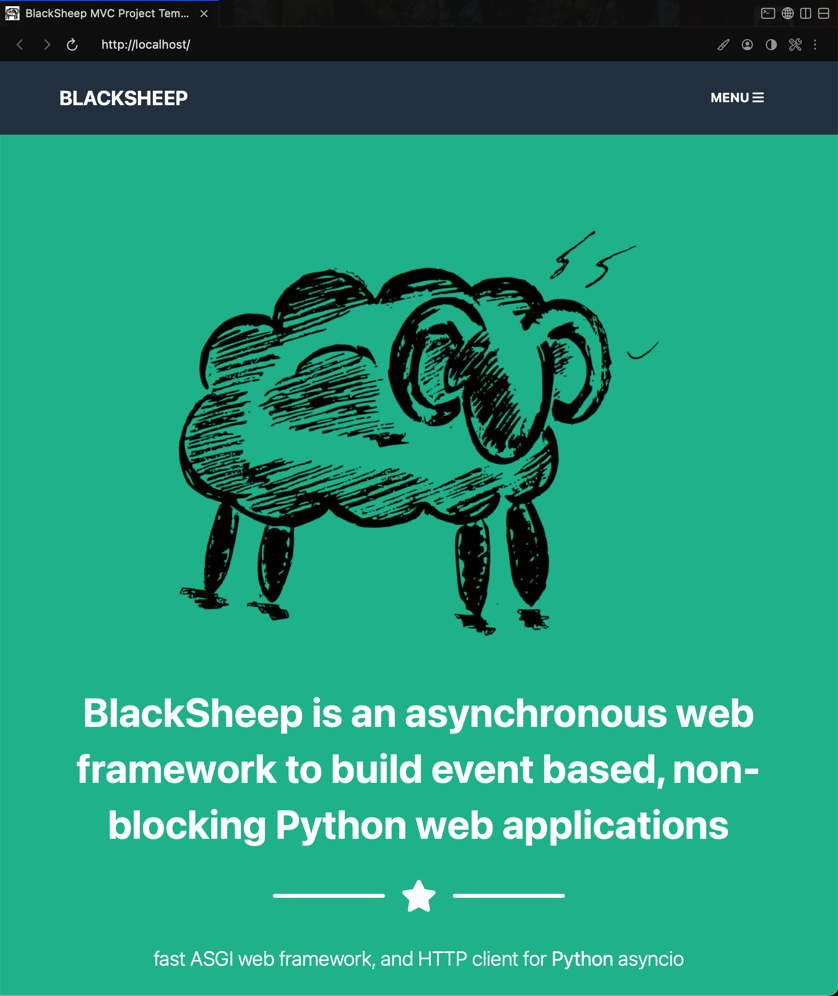

### 4.8 Memeriksa distribusi request

Log Nginx dan log masing-masing instance diperiksa setelah beberapa request dikirim.

```bash
docker logs nginx
docker compose logs bs_app
```

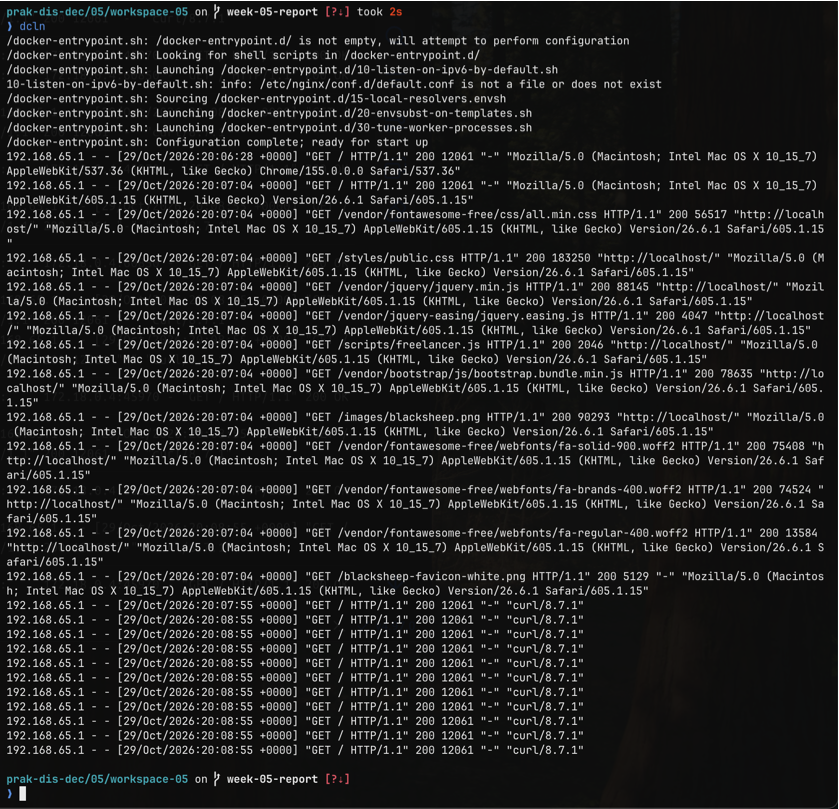

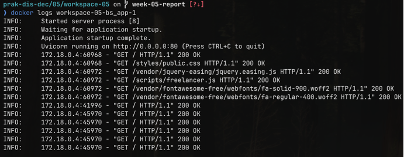

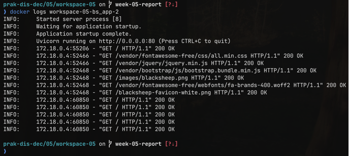

Hasil ini menunjukkan bahwa request masuk melalui Nginx, bukan langsung ke container aplikasi. Nginx kemudian meneruskan request ke backend yang tersedia.

### 4.9 Menguji kondisi salah satu instance berhenti

Salah satu container aplikasi dihentikan untuk melihat apakah instance lain masih dapat melayani request.

```bash
docker stop <nama-container-bs_app-1>
curl http://localhost
```

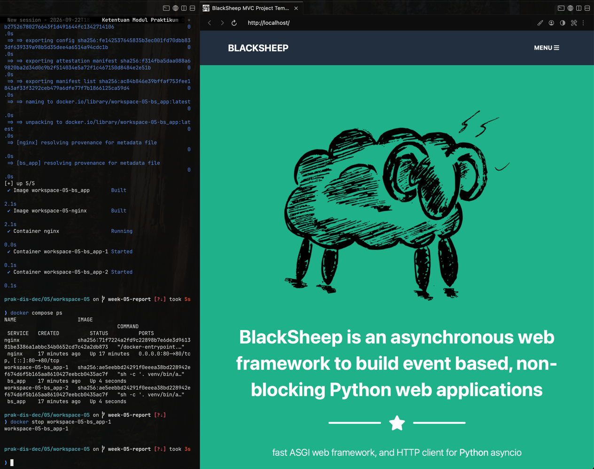

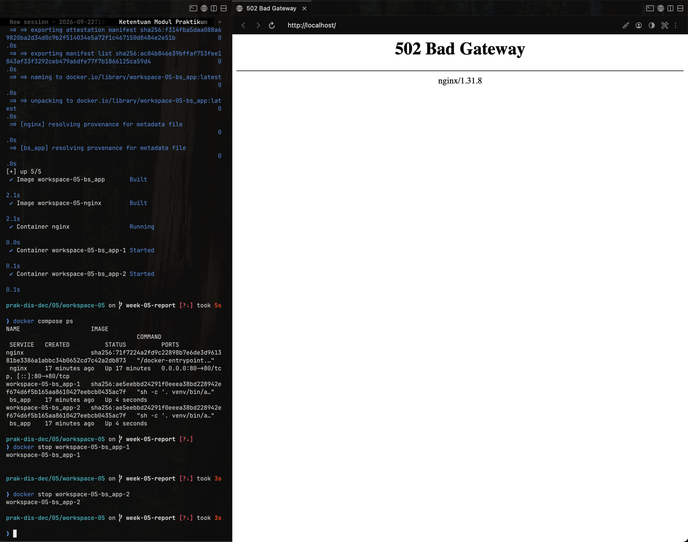

Aplikasi masih dapat diakses melalui Nginx karena instance lainnya tetap berjalan. Hasil ini menunjukkan manfaat menjalankan lebih dari satu instance.

Setelah pengujian selesai, seluruh container dihentikan.

```bash
docker compose down
```

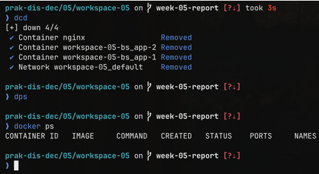

### 4.10 Pengujian heartbeat

Untuk pengujian failure detection, aplikasi dijalankan kembali pada port `44777`.

Terminal pertama:

```bash
cd blacksheep_lb
python -m uvicorn app.main:app --host 0.0.0.0 --port 44777
```

Terminal kedua:

```bash
python heartbeat/check-server.py
```

Ketika aplikasi aktif, script dapat terhubung ke server dan memperoleh response.

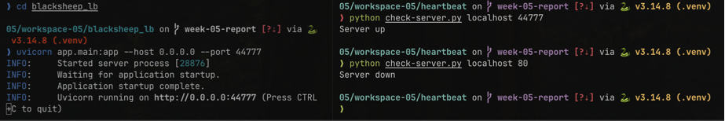

Server kemudian dihentikan menggunakan `Ctrl+C`. Script heartbeat dijalankan kembali.

```bash
python heartbeat/check-server.py
```

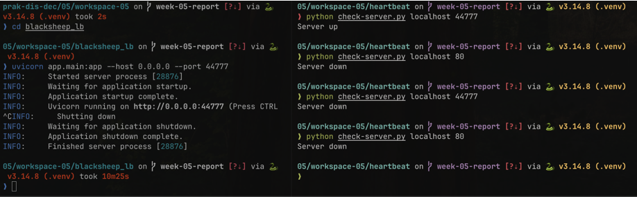

Pada kondisi ini koneksi gagal. Perbedaan kedua hasil tersebut menunjukkan bahwa heartbeat dapat digunakan untuk membedakan service yang aktif dari service yang tidak merespons.

### 4.11 Pengujian retry dengan Tenacity

Tenacity dipasang sebagai dependency untuk mengatur pengulangan request yang gagal.

```bash
uv pip install tenacity
```

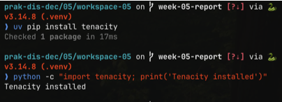

Saat aplikasi aktif, script retry berhasil mendapatkan response tanpa perlu melakukan banyak percobaan.

```bash
python failure-detection/check-retry.py
```

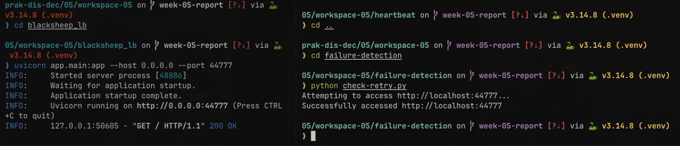

Setelah server dimatikan, script melakukan percobaan ulang sesuai konfigurasi. Jika seluruh percobaan gagal, error koneksi ditampilkan.

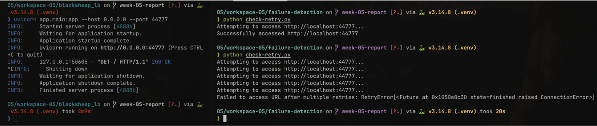

Retry membantu menghadapi gangguan sementara, tetapi tidak dapat membuat service yang benar-benar mati menjadi tersedia kembali.

### 4.12 Pengujian circuit breaker

Script circuit breaker dijalankan saat aplikasi aktif.

```bash
python failure-detection/check-circuit-breaker.py
```

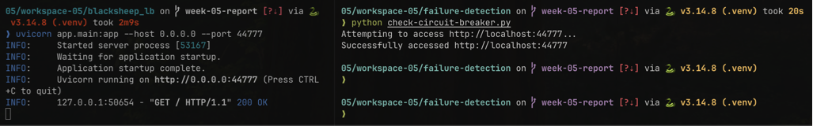

Pada kondisi aktif, request berhasil dan circuit tetap berada pada keadaan `closed`.

Selanjutnya aplikasi dihentikan dan script dijalankan kembali.

```bash
python failure-detection/check-circuit-breaker.py
```

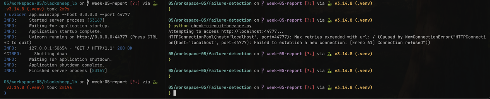

Ketika kegagalan terjadi berulang, circuit berpindah dari `closed` menjadi `open`. Request berikutnya tidak langsung diteruskan ke service yang gagal. Setelah waktu tunggu, circuit dapat masuk ke `half-open` untuk menguji pemulihan service.

---

## 5. Hasil Praktikum

| No. | Pengujian | Kondisi | Hasil |
|---:|---|---|---|
| 1 | Aplikasi Blacksheep lokal | Server aktif pada port `44777` | Aplikasi dapat diakses |
| 2 | Container aplikasi | Image berhasil dibangun dan dijalankan | Aplikasi dapat diakses dari container |
| 3 | Load balancing | Dua instance `bs_app` dan satu Nginx | Request diteruskan melalui Nginx |
| 4 | Kegagalan instance | Satu container `bs_app` dihentikan | Instance lain masih melayani request |
| 5 | Heartbeat | Server aktif | Koneksi berhasil |
| 6 | Heartbeat | Server tidak aktif | Koneksi gagal terdeteksi |
| 7 | Retry | Server aktif | Request berhasil |
| 8 | Retry | Server tidak aktif | Request diulang lalu gagal setelah batas percobaan |
| 9 | Circuit breaker | Server aktif | Circuit berada pada `closed` |
| 10 | Circuit breaker | Server tidak aktif | Circuit berpindah menuju `open` |

---

## 6. Analisis

Penerapan load balancing pada praktikum ini memisahkan fungsi penerimaan request dari fungsi pemrosesan aplikasi. Client berkomunikasi dengan Nginx pada port 80, sedangkan aplikasi Blacksheep berjalan di belakang Nginx. Pemisahan ini membuat konfigurasi aplikasi tidak perlu dibuka langsung ke host.

Scaling `bs_app` menjadi dua instance memberikan redundansi. Ketika satu container dihentikan, container lain masih dapat menerima request. Namun, hasil ini tidak berarti sistem bebas dari kegagalan. Jika seluruh instance aplikasi mati atau Nginx berhenti, layanan tetap tidak dapat diakses. Dengan kata lain, scaling mengurangi single point of failure pada lapisan aplikasi, tetapi belum menghilangkan semua kemungkinan kegagalan.

Pengujian heartbeat menunjukkan bahwa status service dapat diketahui melalui percobaan koneksi. Pada saat server aktif, koneksi berhasil. Saat server dihentikan, kegagalan koneksi langsung terlihat. Informasi semacam ini penting bagi sistem pemantauan, walaupun heartbeat sendiri belum melakukan proses pemulihan.

Retry memberikan kesempatan tambahan bagi service yang mengalami gangguan sementara. Mekanisme ini tidak cocok digunakan tanpa batas karena dapat menambah beban dan memperpanjang waktu tunggu. Circuit breaker melengkapi retry dengan menghentikan request setelah kegagalan berulang. Dengan demikian, service yang sudah gagal tidak terus-menerus menerima request dan kegagalan tidak mudah menyebar ke komponen lain.

Dari rangkaian pengujian tersebut terlihat bahwa fault tolerance biasanya dibangun dari beberapa mekanisme yang saling melengkapi: beberapa instance untuk redundansi, load balancer untuk distribusi request, heartbeat untuk deteksi, retry untuk gangguan sementara, dan circuit breaker untuk membatasi dampak kegagalan.

---

## 7. Kendala dan Solusi

| Kendala | Solusi |
|---|---|
| `ModuleNotFoundError: No module named 'blacksheep'` saat menjalankan `dev.py` | Mengaktifkan virtual environment yang benar lalu memasang dependency menggunakan `python -m pip` atau `uv pip`. |
| Aplikasi lokal dan aplikasi container menggunakan port berbeda | Port `44777` digunakan untuk pengujian lokal failure detection, sedangkan port internal container dan Nginx menggunakan port `80`. |
| Request tidak langsung diarahkan ke container aplikasi | Request diarahkan melalui `http://localhost` agar masuk ke Nginx sebagai reverse proxy. |
| Salah satu instance aplikasi berhenti | Instance kedua tetap dijalankan sehingga request masih dapat dilayani. |
| Server tidak aktif saat pengujian retry | Kondisi tersebut memang digunakan untuk mengamati percobaan ulang dan error setelah batas retry tercapai. |

---

## 8. Kesimpulan

Praktikum Fault Tolerance berhasil menerapkan load balancing menggunakan dua instance aplikasi Blacksheep dan Nginx sebagai reverse proxy. Docker Compose digunakan untuk membangun serta menjalankan seluruh service, sedangkan opsi `--scale bs_app=2` digunakan untuk menggandakan aplikasi.

Pengujian menunjukkan bahwa aplikasi masih dapat diakses ketika salah satu instance dihentikan. Selain itu, heartbeat berhasil membedakan service aktif dan tidak aktif, Tenacity melakukan retry saat koneksi gagal, dan circuit breaker membatasi request ketika kegagalan terjadi berulang. Kombinasi mekanisme tersebut memberikan dasar fault tolerance pada aplikasi terdistribusi.

---

## 9. Referensi

1. Modul 5 Praktikum Sistem Terdistribusi dan Terdesentralisasi, Universitas Teknologi Digital Indonesia, *Fault Tolerance*.
2. Blacksheep Documentation. https://www.neoteroi.dev/blacksheep/
3. Docker Compose Documentation. https://docs.docker.com/compose/
4. Nginx Documentation. https://nginx.org/en/docs/
5. Tenacity Documentation. https://tenacity.readthedocs.io/

