# Laporan Praktikum Sistem Terdistribusi dan Terdesentralisasi

## Pertemuan 06 — Distributed File System (HDFS)

### Identitas

- Nama: **Zul Ikhwanul Anggara**
- NIM: **255410043**
- Kelas: **Informatika-1**
- Tanggal praktikum: **12 November 2026**

---

## 1. Tujuan

Praktikum ini bertujuan memasang Apache Hadoop 3.5.0 dalam mode pseudo-distributed pada Kali Linux, lalu menjalankan HDFS sebagai sistem berkas terdistribusi di atas satu mesin. Serangkaian langkah dilakukan mulai dari penyiapan JDK, `pdsh`, dan SSH antar proses, konfigurasi empat berkas XML Hadoop, format NameNode, sampai menjalankan daemon HDFS.

Selain berhasil menyalakan layanan, praktikum ini juga menguji pemakaian HDFS melalui shell `hdfs dfs` dan melalui antarmuka web NameNode pada port 9870. Bagian akhir praktikum berupa tugas: membuat direktori `/user/<nama-user>/datasets` di HDFS dan memindahkan tiga berkas CSV hasil unduhan dari internet ke direktori tersebut. Dengan demikian, praktikum tidak berhenti pada instalasi, tetapi sampai pada pembuktian bahwa berkas benar-benar tersimpan di dalam HDFS dan dapat dibaca kembali.

---

## 2. Dasar Teori

### 2.1 Hadoop Distributed File System

HDFS adalah sistem berkas terdistribusi yang menyimpan data dalam blok-blok berukuran besar dan menyebarkannya ke beberapa DataNode. Sebuah berkas tidak disimpan utuh pada satu mesin, melainkan dipecah menjadi blok yang direplikasi. Pada mode pseudo-distributed, NameNode, DataNode, dan SecondaryNameNode berjalan sebagai proses terpisah pada satu komputer, sehingga perilaku HDFS dapat dipelajari tanpa harus menyiapkan banyak server.

NameNode menyimpan metadata, yaitu struktur direktori, nama berkas, pemetaan blok, dan lokasi replika. DataNode menyimpan blok data yang sesungguhnya. Karena metadata berada di NameNode, HDFS tidak dapat dipakai ketika NameNode mati, walaupun DataNode masih menyimpan blok. SecondaryNameNode bukan cadangan otomatis NameNode; tugasnya membantu proses checkpoint metadata.

### 2.2 Replikasi dan mode pseudo-distributed

Nilai `dfs.replication` menentukan berapa salinan setiap blok. Pada praktikum ini nilainya `1` karena hanya tersedia satu DataNode. Jika nilai replikasi lebih besar daripada jumlah DataNode yang hidup, HDFS tetap menerima berkas, tetapi blok berstatus *under-replicated* sampai ada DataNode tambahan.

Mode pseudo-distributed dipilih karena modul memang mengarahkan seluruh konfigurasi ke `localhost`. Walaupun disebut terdistribusi, seluruh komunikasi NameNode–DataNode terjadi di dalam satu mesin melalui port 9000 (RPC) dan 9866 (transfer blok).

### 2.3 YARN dan MapReduce

Walaupun fokus praktikum adalah HDFS, modul juga menyiapkan YARN sebagai pengelola sumber daya dan MapReduce sebagai kerangka komputasi. Berkas `mapred-site.xml` mengarahkan kerangka MapReduce ke YARN, sedangkan `yarn-site.xml` menentukan layanan `mapreduce_shuffle`, daftar environment yang diizinkan, serta batas memori NodeManager. Konfigurasi ini belum dipakai untuk menjalankan job, tetapi menjadi prasyarat agar instalasi Hadoop lengkap dan siap dikembangkan.

### 2.4 Peran SSH dan pdsh

Skrip `start-dfs.sh` dan `stop-dfs.sh` bekerja dengan menjalankan perintah ke host yang terdaftar. Karena itu Hadoop membutuhkan SSH tanpa kata sandi, termasuk ke `localhost`. `pdsh` dipakai sebagai paralel shell untuk menjalankan perintah pada banyak host sekaligus; modul mengharuskan `PDSH_RCMD_TYPE=ssh` agar transport yang dipakai adalah SSH, bukan rsh.

---

## 3. Alat dan Bahan

Praktikum dikerjakan pada Mac Apple Silicon dengan Kali Linux sebagai mesin virtual. Spesifikasi perangkat lunak yang benar-benar dipakai adalah sebagai berikut:

- Kali Linux (aarch64) pada mesin virtual, hostname `george`, alamat `192.168.64.5`;
- OpenJDK 21.0.13 (`/usr/lib/jvm/java-21-openjdk-arm64`);
- Apache Hadoop 3.5.0;
- `pdsh` 2.36 dengan modul `ssh`;
- `openssh-server`, `curl`, `wget`;
- Shell zsh pada terminal, serta browser di macOS untuk membuka NameNode UI.

Modul menyebut JDK 17 dan/atau 21. Pada praktik ini dipakai JDK 21 karena itu versi yang terpasang di sistem, dan Hadoop 3.5.0 tetap berjalan normal. Ketersediaan versi Java diperiksa lebih dahulu bersama versi `pdsh`.

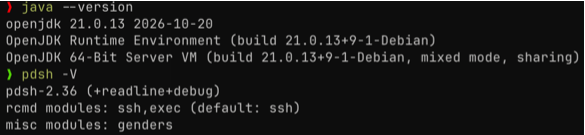

---

## 4. Langkah Pengerjaan

### 4.1 Mengunduh Apache Hadoop 3.5.0

Distribusi Hadoop diambil dari arsip resmi Apache agar versinya sesuai dengan modul. Berkas disimpan di direktori kerja terpisah supaya hasil unduhan tidak bercampur dengan lokasi instalasi.

```bash
mkdir -p ~/master/data-engineering/apache-hadoop
cd ~/master/data-engineering/apache-hadoop
wget https://archive.apache.org/dist/hadoop/common/hadoop-3.5.0/hadoop-3.5.0.tar.gz
ls -lh hadoop-3.5.0.tar.gz
```

Unduhan selesai dengan ukuran sekitar 581 MB. Angka ini wajar untuk distribusi Hadoop yang membawa banyak pustaka Java pihak ketiga.

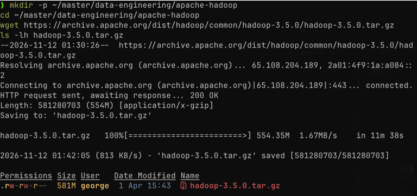

### 4.2 Ekstraksi dan penyiapan `$HADOOP_HOME`

Berkas arsip diekstraksi ke `~/software/storage`, lalu dibuat symlink `hadoop` menuju `hadoop-3.5.0`. Symlink dipakai agar konfigurasi tidak perlu diubah ketika versi Hadoop dinaikkan; cukup arahkan symlink ke direktori versi baru.

```bash
mkdir -p ~/software/storage ~/env/bash/storage
cd ~/software/storage
tar -xvf ~/master/data-engineering/apache-hadoop/hadoop-3.5.0.tar.gz
ln -s hadoop-3.5.0 hadoop
```

Direktori `~/env/bash/storage/hadoop.sh` kemudian diisi variabel lingkungan yang dibutuhkan, lalu di-*source* pada setiap sesi terminal.

```bash
export HADOOP_HOME="$HOME/software/storage/hadoop"
export HADOOP_CONF_DIR="$HADOOP_HOME/etc/hadoop"
export PATH="$HADOOP_HOME/bin:$HADOOP_HOME/sbin:$PATH"
export PDSH_RCMD_TYPE=ssh
```

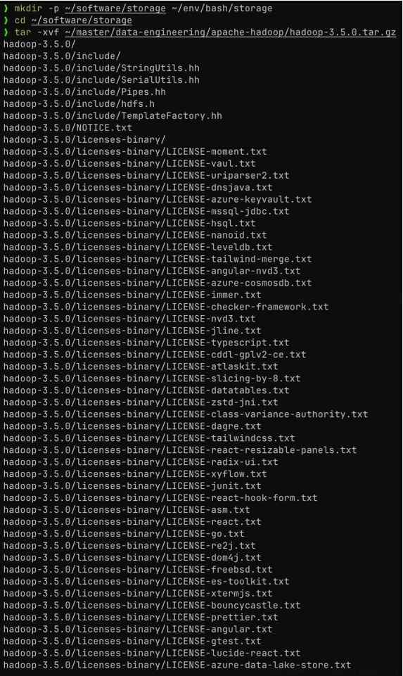

Pemeriksaan instalasi dilakukan dengan menjalankan `hadoop version`. Keluaran yang muncul memuat versi 3.5.0, commit `dbcc7cd797100e6b32cd84f85b53a5193a5f9af0`, serta lokasi jar yang dipakai. Jika perintah ini gagal, berarti variabel `PATH` belum mengarah ke `$HADOOP_HOME/bin`.

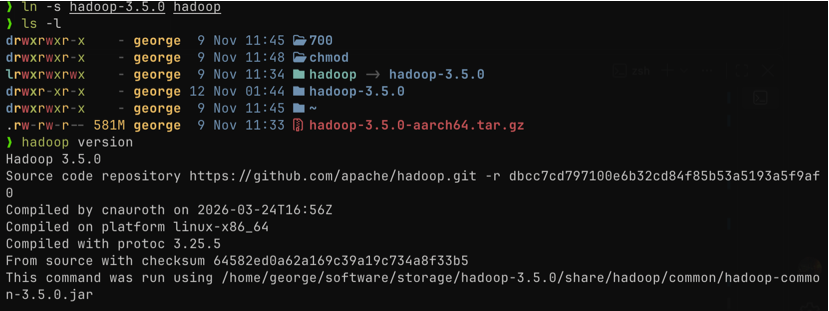

### 4.3 SSH tanpa kata sandi ke localhost

Hadoop menjalankan daemon melalui SSH, sehingga login tanpa kata sandi ke `localhost` harus tersedia. Kunci RSA dibuat (pada praktik ini kunci lama ditimpa), lalu public key dimasukkan ke `authorized_keys` dengan permission `0600`.

```bash
ssh-keygen -t rsa -P '' -f ~/.ssh/id_rsa
cat ~/.ssh/id_rsa.pub >> ~/.ssh/authorized_keys
chmod 0600 ~/.ssh/authorized_keys
ssh localhost 'hostname'
```

Perintah terakhir mengembalikan `george`, artinya SSH lokal sudah tidak meminta kata sandi.

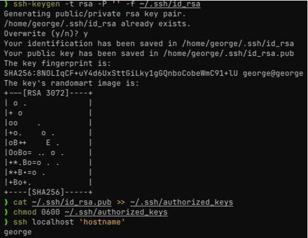

### 4.4 Konfigurasi empat berkas XML

Empat berkas pada `$HADOOP_CONF_DIR` disunting. `hdfs-site.xml` menetapkan faktor replikasi satu karena hanya ada satu DataNode.

```xml
<configuration>
  <property><name>dfs.replication</name><value>1</value></property>
</configuration>
```

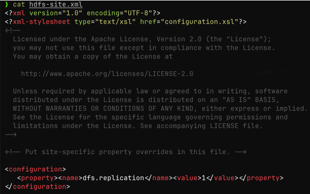

`core-site.xml` menentukan alamat NameNode serta proxy user. Nilai `yourusername` dibiarkan sesuai modul; pada mode lokal tanpa autentikasi tambahan, properti ini tidak memengaruhi akses.

```xml
<configuration>
  <property><name>fs.defaultFS</name><value>hdfs://localhost:9000</value></property>
  <property><name>hadoop.proxyuser.yourusername.groups</name><value>*</value></property>
  <property><name>hadoop.proxyuser.yourusername.hosts</name><value>*</value></property>
</configuration>
```

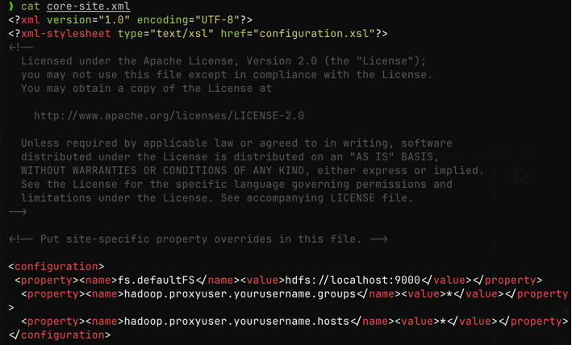

`mapred-site.xml` mengarahkan MapReduce agar berjalan di atas YARN dan mendefinisikan classpath aplikasi.

```xml
<configuration>
  <property><name>mapreduce.framework.name</name><value>yarn</value></property>
  <property><name>mapreduce.application.classpath</name>
    <value>$HADOOP_CLASSPATH:$HADOOP_HOME/share/hadoop/mapreduce/*:$HADOOP_MAPRED_HOME/share/hadoop/mapreduce/lib/*</value></property>
</configuration>
```

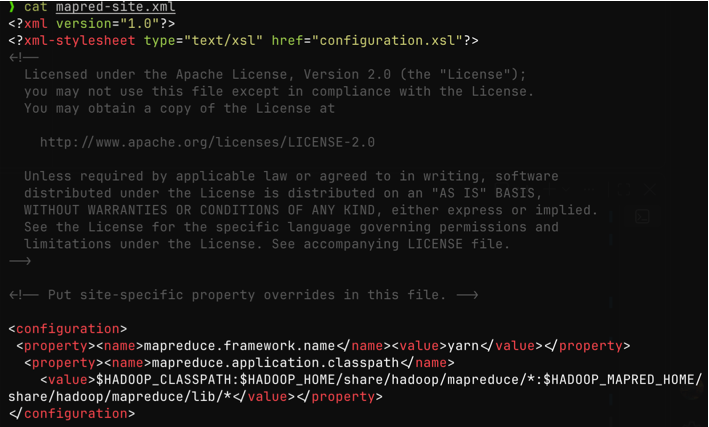

`yarn-site.xml` mengaktifkan `mapreduce_shuffle`, menetapkan daftar environment yang diizinkan, serta mengatur memori NodeManager 4096 MB dengan alokasi minimum 2048 MB dan rasio vmem:pmem 2.1.

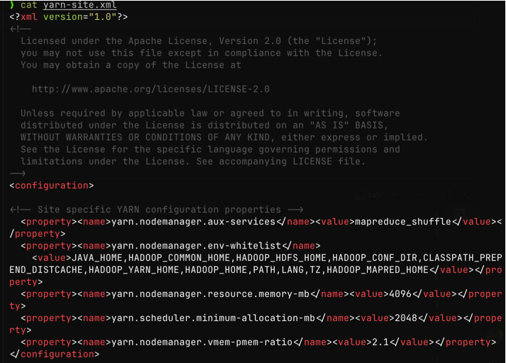

### 4.5 Menetapkan `JAVA_HOME` pada `hadoop-env.sh`

Hadoop tidak membaca `JAVA_HOME` dari shell, melainkan dari `$HADOOP_CONF_DIR/hadoop-env.sh`. Nilai diambil otomatis dari lokasi `java` yang aktif, lalu ditulis satu kali agar tidak ada baris duplikat.

```bash
export JAVA_HOME="$(dirname "$(dirname "$(readlink -f "$(command -v java)")")")"
cd "$HADOOP_HOME/etc/hadoop"
sed -i '/^export JAVA_HOME=/d; /^export LANG=/d' hadoop-env.sh
printf 'export JAVA_HOME=%s\nexport LANG=en_US.UTF-8\n' "$JAVA_HOME" >> hadoop-env.sh
"$JAVA_HOME/bin/java" -version
```

Hasilnya `JAVA_HOME=/usr/lib/jvm/java-21-openjdk-arm64`. Penentuan otomatis ini penting karena Kali pada Apple Silicon memakai direktori `-arm64`, bukan `-amd64` seperti pada mesin x86.

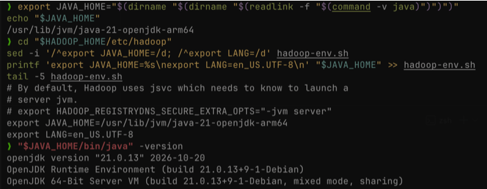

### 4.6 Format NameNode

Format NameNode dijalankan satu kali untuk membuat struktur metadata awal pada penyimpanan HDFS. Proses ini menampilkan `STARTUP_MSG` yang memuat host `george/127.0.1.1`, argumen `[-format]`, dan versi 3.5.0.

```bash
hdfs namenode -format
```

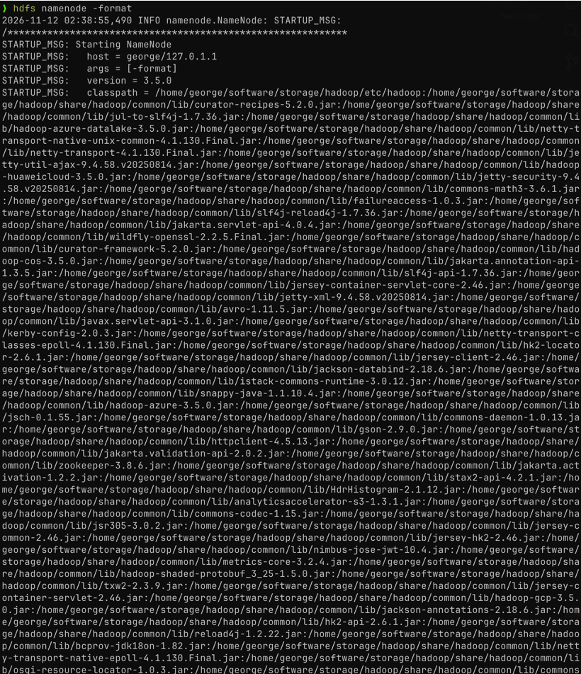

Format ulang pada instalasi yang sudah berisi data akan menghapus metadata lama, sehingga perintah ini tidak boleh diulang tanpa alasan yang jelas.

### 4.7 Menjalankan daemon HDFS dan memeriksa status

Daemon dinyalakan dengan `start-dfs.sh`. Setelah itu `jps` dipakai untuk memastikan tiga proses inti benar-benar hidup, lalu `hdfs dfsadmin -report` dipakai untuk membaca laporan kapasitas dan jumlah DataNode.

```bash
start-dfs.sh
jps
hdfs dfsadmin -report
ss -tlnp | grep -E '9000|9870'
```

Keluaran `jps` menampilkan `DataNode`, `NameNode`, dan `SecondaryNameNode`. Laporan `dfsadmin` menunjukkan satu DataNode hidup di `127.0.0.1:9866` dengan kapasitas 1,91 GB dan `DFS Remaining` 99,94%. Pemeriksaan `ss` memastikan port 9000 (RPC) dan 9870 (HTTP UI) benar-benar mendengarkan.

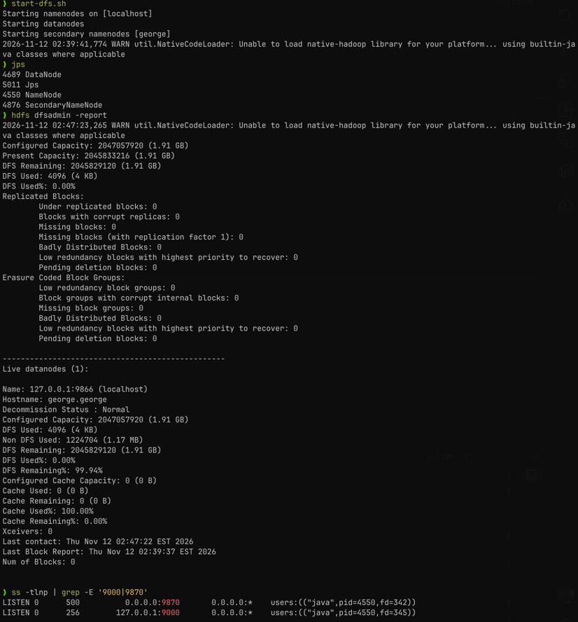

### 4.8 Memantau NameNode melalui web

NameNode UI dibuka dari browser macOS pada `http://192.168.64.5:9870/dfshealth.html#tab-overview`. Halaman Overview menampilkan NameNode aktif pada `localhost:9000`, versi 3.5.0, Cluster ID, Block Pool ID, serta ringkasan kapasitas 1,91 GB. Halaman Datanodes menunjukkan satu node `george-george-9866` berstatus *In service* dengan `Last contact` satu detik, yang berarti heartbeat berjalan normal.

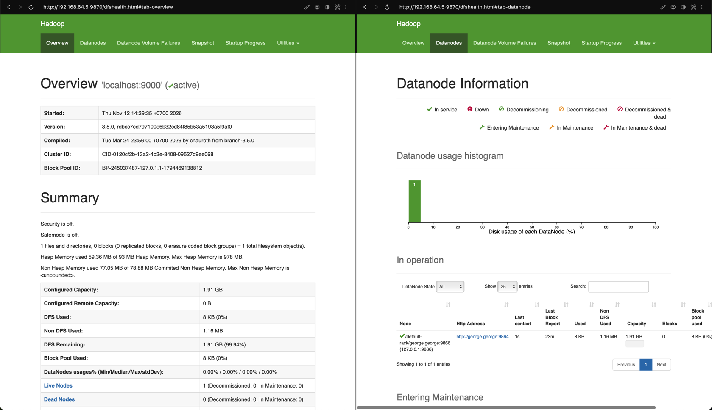

Alamat yang dipakai adalah IP mesin virtual, bukan `localhost`, karena browser berjalan di macOS sedangkan Hadoop berjalan di dalam VM.

### 4.9 Operasi dasar HDFS

Operasi dasar diuji langsung melalui shell. Direktori pengguna dibuat agar setiap berkas tersimpan pada namespace yang sesuai dengan pemiliknya.

```bash
hdfs dfs -ls /
hdfs dfs -mkdir -p /user/$(whoami)
hdfs dfs -ls -R /user
```

Direktori `/user/george` terbentuk dengan pemilik `george` dan grup `supergroup`, sesuai hasil `-ls -R`.

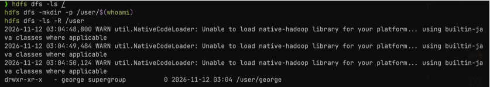

### 4.10 Tugas 1 — membuat direktori `datasets`

Direktori tugas dibuat di dalam direktori pengguna, kemudian keberadaannya diverifikasi.

```bash
hdfs dfs -mkdir -p /user/$(whoami)/datasets
hdfs dfs -ls /user/$(whoami)
```

Hasil `-ls` menampilkan satu entri `/user/george/datasets` bertipe direktori.

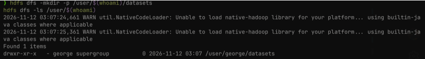

### 4.11 Tugas 2 — mengunduh tiga CSV dan memasukkannya ke HDFS

Tiga berkas CSV diambil dari repositori data publik, lalu diperiksa ukurannya di filesystem lokal sebelum diunggah.

```bash
mkdir -p ~/datasets && cd ~/datasets
curl -LO https://raw.githubusercontent.com/datasciencedojo/datasets/master/titanic.csv
curl -LO https://raw.githubusercontent.com/plotly/datasets/master/iris.csv
curl -LO https://raw.githubusercontent.com/datasciencedojo/datasets/master/WorldDBTables/City.csv
ls -lh *.csv
```

Berkas yang diperoleh adalah `titanic.csv` (58,89 KB), `iris.csv` (4,49 KB), dan `City.csv` (14 B). `City.csv` berukuran sangat kecil karena isinya hanya header tanpa baris data, tetapi tetap sah sebagai berkas CSV.

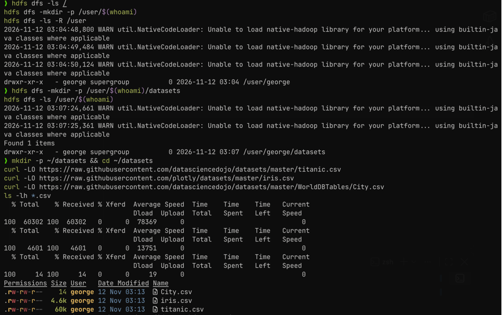

Ketiga berkas kemudian dimasukkan ke HDFS menggunakan `-put`, lalu diverifikasi dengan `-ls -h` dan dibaca sebagian menggunakan `-cat`.

```bash
hdfs dfs -put ~/datasets/*.csv /user/$(whoami)/datasets/
hdfs dfs -ls -h /user/$(whoami)/datasets
hdfs dfs -cat /user/$(whoami)/datasets/titanic.csv | head -5
```

Hasil `-ls -h` menampilkan `Found 3 items` dengan ukuran yang sama seperti berkas lokal, sedangkan `-cat` mengeluarkan header `PassengerId,Survived,Pclass,Name,...` beserta empat baris pertama. Muncul pesan `cat: Unable to write to output stream` karena `head` menutup pipe lebih awal; pesan ini bukan kegagalan penyimpanan.

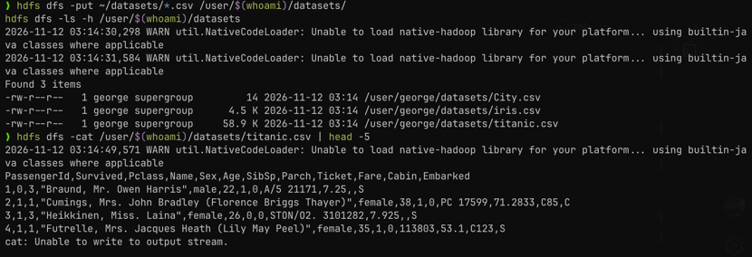

### 4.12 Verifikasi melalui File System Explorer

Hasil unggahan juga diperiksa dari sisi web pada `http://192.168.64.5:9870/explorer.html#/user/george/datasets`. Halaman Browse Directory menampilkan tiga berkas dengan pemilik `george`, grup `supergroup`, replikasi 1, dan block size 128 MB.

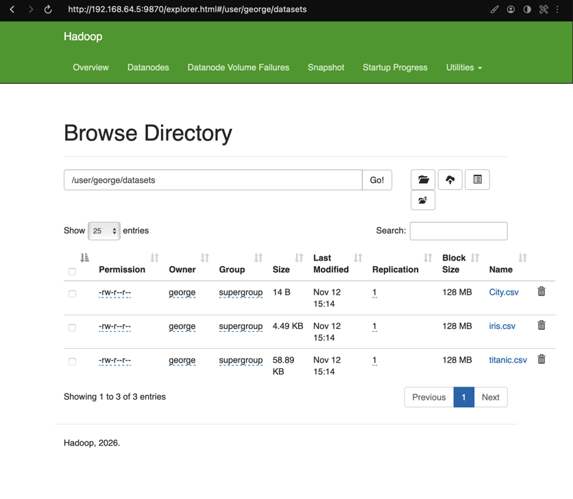

### 4.13 Menghentikan HDFS

Setelah seluruh pengujian selesai, daemon HDFS dihentikan dengan `stop-dfs.sh` dan dipastikan tidak ada proses tersisa melalui `jps`.

```bash
stop-dfs.sh
jps
```

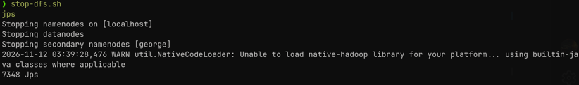

---

## 5. Hasil Praktikum

| No. | Pengujian                        | Perintah / Kondisi                              | Hasil                                                          |
| --: | -------------------------------- | ----------------------------------------------- | -------------------------------------------------------------- |
|   1 | Versi Java dan pdsh              | `java -version`, `pdsh -V`                      | OpenJDK 21.0.13, pdsh 2.36 dengan modul ssh                    |
|   2 | Instalasi Hadoop                 | `hadoop version`                                | Hadoop 3.5.0 terbaca dari `~/software/storage/hadoop`          |
|   3 | SSH ke localhost                 | `ssh localhost 'hostname'`                      | Berhasil tanpa kata sandi, mengembalikan `george`              |
|   4 | Konfigurasi XML                  | 4 berkas di `$HADOOP_CONF_DIR`                  | `fs.defaultFS=hdfs://localhost:9000`, replikasi 1              |
|   5 | `JAVA_HOME`                      | `hadoop-env.sh`                                 | `java-21-openjdk-arm64`, terverifikasi lewat `bin/java -version`|
|   6 | Format NameNode                  | `hdfs namenode -format`                         | Metadata awal terbentuk, versi 3.5.0                           |
|   7 | Daemon HDFS                      | `start-dfs.sh`, `jps`                           | NameNode, DataNode, SecondaryNameNode hidup                    |
|   8 | Status HDFS                      | `hdfs dfsadmin -report`                         | 1 DataNode hidup, kapasitas 1,91 GB, sisa 99,94%               |
|   9 | Web UI NameNode                  | `http://192.168.64.5:9870`                      | Overview aktif, 1 live node, 0 dead node                       |
|  10 | Tugas 1                          | `hdfs dfs -mkdir -p /user/george/datasets`      | Direktori `/user/george/datasets` terbentuk                    |
|  11 | Tugas 2                          | `hdfs dfs -put ~/datasets/*.csv ...`            | 3 berkas CSV tersimpan di HDFS                                 |
|  12 | Verifikasi data                  | `hdfs dfs -ls -h`, `-cat`, File System Explorer | Ukuran sesuai, isi titanic.csv terbaca, 3 file tampil di web   |
|  13 | Penghentian layanan              | `stop-dfs.sh`, `jps`                            | Seluruh daemon berhenti                                        |

---

## 6. Analisis

Praktikum ini memperlihatkan bahwa HDFS dapat dijalankan pada satu mesin tanpa kehilangan sifat dasarnya: ada pemisahan tegas antara pengelola metadata dan penyimpan data. NameNode menyimpan peta blok dan struktur direktori, sedangkan DataNode menyimpan isi berkas. Ketika `hdfs dfs -put` dijalankan, berkas tidak disalin ke satu direktori biasa, melainkan dipecah menjadi blok, didaftarkan pada NameNode, lalu ditulis ke DataNode. Hal ini terlihat pada File System Explorer yang menampilkan block size 128 MB serta nilai replikasi 1 untuk setiap berkas.

Nilai replikasi 1 adalah konsekuensi langsung dari topologi satu node. HDFS tetap menerima berkas, tetapi tidak ada redundansi: jika DataNode berhenti atau direktori datanya hilang, blok tidak dapat dipulihkan. Karena itu, praktik ini belum menguji fault tolerance penyimpanan, hanya menguji bahwa jalur tulis–baca berfungsi. Untuk melihat replikasi bekerja, dibutuhkan minimal dua DataNode dan nilai `dfs.replication` yang lebih besar dari satu, sehingga `dfsadmin -report` akan menampilkan beberapa node dan status blok yang tereplikasi penuh.

Perbedaan antara berjalan sebagai proses lokal dan sebagai layanan jaringan juga terasa saat pengujian web. NameNode mendengarkan di port 9870 pada antarmuka mesin virtual, sehingga browser di host macOS harus memakai `192.168.64.5`, bukan `localhost`. Kejadian ini menegaskan bahwa `localhost` selalu merujuk ke mesin tempat browser berjalan, bukan ke VM. Setelah alamat yang benar dipakai, halaman Overview dan Datanodes menampilkan data yang konsisten dengan keluaran terminal: satu node hidup, kapasitas 1,91 GB, dan `Last contact` satu detik yang menandakan heartbeat berjalan.

Seluruh berkas konfigurasi menunjukkan sifat Hadoop yang sangat bergantung pada detail kecil. `JAVA_HOME` yang salah, misalnya menunjuk `-amd64` pada sistem ARM, membuat semua perintah `hdfs` gagal walaupun Java sudah terpasang. Hal serupa berlaku untuk `PATH`, SSH tanpa kata sandi, dan lokasi `hadoop-env.sh`. Dengan kata lain, keberhasilan praktikum ini bukan hasil satu perintah besar, tetapi hasil dari beberapa prasyarat kecil yang harus konsisten satu sama lain. Pola ini umum pada sistem terdistribusi: lapisan layanan baru bisa berjalan ketika lapisan di bawahnya benar-benar siap.

Dari sisi tugas, pemindahan tiga CSV ke `/user/george/datasets` membuktikan bahwa HDFS dapat menjadi tempat penyimpanan bersama untuk data yang nantinya diolah MapReduce atau Spark. Berkas `titanic.csv` yang dibaca kembali dengan `-cat` menunjukkan bahwa data yang ditulis melalui satu antarmuka (shell) dapat diakses melalui antarmuka lain (web explorer) tanpa konversi. Inilah manfaat utama lapisan abstrak filesystem: aplikasi tidak perlu tahu di DataNode mana blok berada.

---

## 7. Kendala dan Solusi

| Kendala                                                                                          | Solusi                                                                                                                                     |
| ------------------------------------------------------------------------------------------------ | ------------------------------------------------------------------------------------------------------------------------------------------ |
| `ERROR: JAVA_HOME /usr/lib/jvm/java-17-openjdk-amd64 does not exist`                             | Kali pada Apple Silicon memakai direktori `-arm64`. `JAVA_HOME` diambil otomatis dari `readlink -f $(command -v java)` menjadi `java-21-openjdk-arm64`. |
| `hadoop-env.sh` berisi beberapa baris `export JAVA_HOME` dan `export LANG` akibat penambahan berulang | Baris lama dihapus dengan `sed`, lalu satu baris `JAVA_HOME` dan `LANG` ditulis ulang di akhir berkas.                                     |
| `hadoop` tidak dikenali pada shell zsh                                                           | Variabel `PATH`, `HADOOP_HOME`, dan `HADOOP_CONF_DIR` disetel melalui `~/env/bash/storage/hadoop.sh` yang di-*source* setiap sesi.          |
| `http://localhost:9870` menolak koneksi pada browser macOS                                       | Browser berjalan di host, Hadoop berjalan di VM. UI diakses melalui IP VM `http://192.168.64.5:9870`.                                       |
| `WARN util.NativeCodeLoader: Unable to load native-hadoop library`                               | Peringatan ini normal pada build tanpa pustaka native; Hadoop memakai implementasi Java dan tetap berjalan.                                 |
| `cat: Unable to write to output stream` saat `hdfs dfs -cat ... \| head -5`                      | `head` menutup pipe lebih awal sehingga `hdfs` kehilangan tujuan tulis. Data tetap utuh; verifikasi dilanjutkan dengan `-ls -h`.             |
| `City.csv` hanya 14 byte                                                                         | Berkas sumber memang hanya berisi header. Berkas tetap valid sebagai CSV dan berhasil disimpan di HDFS.                                       |

---

## 8. Kesimpulan

Apache Hadoop 3.5.0 berhasil dipasang dan dijalankan dalam mode pseudo-distributed pada Kali Linux ARM64. NameNode, DataNode, dan SecondaryNameNode aktif, port 9000 dan 9870 mendengarkan, dan NameNode UI menampilkan satu DataNode hidup dengan kapasitas 1,91 GB. Konfigurasi `dfs.replication=1`, `fs.defaultFS=hdfs://localhost:9000`, serta pengaturan YARN terbaca dengan benar oleh layanan.

Kedua tugas praktikum juga selesai. Direktori `/user/george/datasets` berhasil dibuat di HDFS, lalu tiga berkas CSV (`titanic.csv`, `iris.csv`, dan `City.csv`) diunggah dan diverifikasi melalui `hdfs dfs -ls -h`, `-cat`, dan File System Explorer. Hasil ini menunjukkan bahwa HDFS sudah siap dipakai sebagai penyimpanan data untuk praktikum berikutnya, dengan catatan bahwa tanpa DataNode tambahan belum ada redundansi blok.

---

## 9. Referensi

1. Modul 6 Praktikum Sistem Terdistribusi dan Terdesentralisasi, Universitas Teknologi Digital Indonesia, _Distributed File System — HDFS_.
2. Apache Hadoop 3.5.0 Documentation. https://hadoop.apache.org/docs/current/
3. HDFS Commands Guide (FileSystem Shell). https://hadoop.apache.org/docs/current/hadoop-project-dist/hadoop-common/FileSystemShell.html
4. HDFS Architecture Guide. https://hadoop.apache.org/docs/current/hadoop-project-dist/hadoop-hdfs/HdfsDesign.html
5. Hadoop: The Definitive Guide, Tom White, O'Reilly.
