# Laporan Praktikum Sistem Terdistribusi dan Terdesentralisasi

## Pertemuan 07 — Cloud Computing dan Containerized App

### Identitas

- Nama: **Zul Ikhwanul Anggara**
- NIM: **255410043**
- Kelas: **Informatika-1**
- Tanggal praktikum: **12 November 2026**

---

## 1. Tujuan

Praktikum ini bertujuan memahami pendekatan XaaS (*Everything as a Service*) pada cloud computing, lalu mempraktikkannya dengan mengubah sebuah aplikasi web biasa menjadi *Containerized App*. Aplikasi yang dipakai adalah aplikasi blog `flaskr` dari tutorial resmi Flask, dijalankan lebih dahulu secara lokal dengan Python 3.14, kemudian dibungkus menjadi image container.

Pembungkusan dilakukan dua kali dengan dua *container engine* berbeda, yaitu Docker dan Podman, memakai `Dockerfile` yang sama. Hasil akhir yang diharapkan adalah aplikasi blog yang dapat diakses dari browser pada port 5001 di host, serta pemahaman perbedaan cara kerja Docker (memerlukan daemon) dan Podman (daemonless).

---

## 2. Dasar Teori

### 2.1 XaaS: SaaS, PaaS, IaaS

Cloud computing dengan pendekatan XaaS memandang sumber daya komputasi sebagai layanan, bukan sebagai perangkat yang harus dimiliki. Pembagian yang paling umum adalah tiga lapis berikut.

**IaaS** menyediakan infrastruktur mentah: mesin virtual, jaringan, dan penyimpanan blok. Konsumen bertanggung jawab memasang sistem operasi dan seluruh tumpukan perangkat lunak di atasnya. Contohnya AWS EC2, DigitalOcean Droplet, dan GCP Compute Engine.

**PaaS** menaikkan abstraksi satu tingkat. Provider mengelola sistem operasi, runtime bahasa, dan pipeline build, sedangkan konsumen hanya mengunggah kode aplikasi. Contohnya Vercel, Railway, Heroku, dan Google App Engine.

**SaaS** adalah lapisan paling atas: aplikasi lengkap yang langsung dipakai lewat browser. Konsumen hanya mengelola data dan hak akses pengguna. Contohnya Google Workspace, Microsoft 365, Salesforce, dan Zoom.

Semakin tinggi lapisan yang dipakai, semakin sedikit bagian yang dikelola konsumen, tetapi semakin kecil pula kendali atas konfigurasi di bawahnya.

### 2.2 Virtualisasi dan container

Mesin virtual meniru perangkat keras sehingga setiap VM membawa sistem operasi lengkap dengan kernelnya sendiri. Container tidak meniru perangkat keras: container berbagi kernel host dan hanya mengisolasi proses, sistem berkas, serta jaringan memakai fitur kernel Linux (`namespaces` dan `cgroups`). Akibatnya container jauh lebih ringan dan cepat dinyalakan, tetapi container Linux membutuhkan kernel Linux.

Karena itu, pada macOS container tidak berjalan langsung di atas kernel macOS. Docker Desktop dan Podman menjalankan satu mesin virtual Linux kecil terlebih dahulu, lalu seluruh container berjalan di dalam VM tersebut. Perintah `docker` dan `podman` di macOS sebenarnya berbicara dengan daemon di dalam VM itu.

### 2.3 Image, container, dan port mapping

Image bersifat *immutable*: image adalah cetakan berisi sistem berkas aplikasi dan metadata perintah saat dijalankan. Container adalah instans yang berjalan dari image tersebut. Perubahan yang terjadi di dalam container (misalnya berkas basis data SQLite yang dibuat aplikasi) hilang ketika container dihapus, kecuali disimpan pada volume.

Karena container memiliki ruang jaringan sendiri, port di dalam container tidak otomatis dapat diakses dari host. Pemetaan `-p 5001:5000` berarti port 5001 pada host diteruskan ke port 5000 di dalam container, sesuai ketentuan modul.

### 2.4 Docker dan Podman

Docker memakai arsitektur client–server: perintah `docker` mengirim permintaan ke `dockerd` yang berjalan sebagai layanan sistem. Podman dirancang *daemonless*: setiap container dijalankan sebagai proses anak dari perintah `podman` itu sendiri, sehingga tidak ada layanan latar yang harus dinyalakan lebih dahulu. Podman tetap dapat membaca `Dockerfile` dan sebagian besar perintahnya kompatibel dengan Docker.

### 2.5 Aplikasi `flaskr`

`flaskr` adalah aplikasi blog contoh dari tutorial Flask: pengguna dapat register, login, lalu membuat, mengubah, dan menghapus post. Aplikasi memakai *application factory* (`create_app`), blueprint `auth` dan `blog`, serta basis data SQLite yang dibuat melalui perintah `flask --app flaskr init-db`.

---

## 3. Alat dan Bahan

Praktikum dikerjakan langsung pada macOS di Mac Apple Silicon, tanpa mesin virtual tambahan untuk Docker karena Docker Desktop sudah terpasang.

- macOS 15.7.9 (Darwin, arm64), hostname `macbookpro`
- Docker Desktop 29.9.2 (client dan server), backend Linux VM `aarch64`
- Podman 6.2.0 dengan `podman machine` (VM libkrun, 4 vCPU, 2 GiB RAM)
- `uv` 0.13.0 dan CPython 3.14.8
- Flask 3.1.3, Werkzeug 3.1.9, Jinja2 3.1.6
- `git`, `curl`, dan browser (Chrome/Safari)
- Source: <https://github.com/pallets/flask> tag `3.1.3`, direktori `examples/tutorial`

Modul meminta Python 3.14.4. Repositori `uv` hanya menyediakan patch terbaru pada seri 3.14, yaitu 3.14.8, sehingga versi itu yang dipakai. Perbedaan patch tidak mempengaruhi hasil praktikum.

---

## 4. Langkah Pengerjaan

### 4.1 Tugas 0 — Vendor dan arsitektur XaaS

**Contoh vendor dan layanan yang disediakan.**

| Kategori | Vendor | Layanan yang diberikan |
| --- | --- | --- |
| SaaS | Google Workspace | Gmail, Google Drive, Docs, Meet. Seluruh aplikasi berjalan di infrastruktur Google dan diakses lewat browser; konsumen hanya mengelola akun, kuota, dan data pengguna. |
| PaaS | Vercel | Runtime serverless, pipeline build otomatis dari repositori Git, preview deployment per *pull request*, serta CDN/edge network. Konsumen menyerahkan kode; OS, penskalaan, dan TLS diurus provider. |
| IaaS | AWS EC2 | Mesin virtual (instance) dengan pilihan tipe CPU/RAM, volume penyimpanan EBS, VPC untuk jaringan, dan security group. Konsumen memasang OS image dan seluruh aplikasi sendiri. |

**Arsitektur XaaS secara umum.**

Tiga lapis layanan disusun bertumpuk: IaaS paling bawah (infrastruktur fisik dan virtualisasi dikelola provider), PaaS di tengah (runtime dan pipeline ditambahkan provider), SaaS paling atas (aplikasi jadi). Semakin naik lapisan, semakin sedikit komponen yang dikelola konsumen.

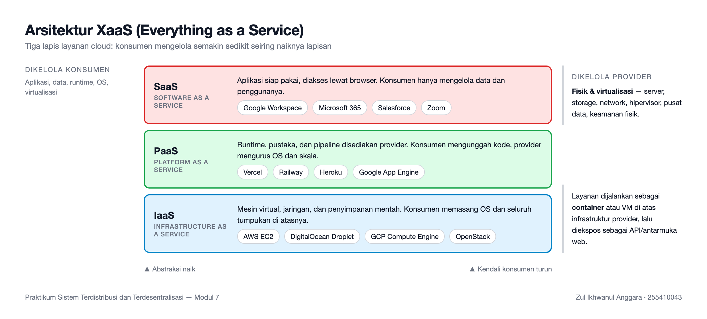

### 4.2 Mengambil source aplikasi

```bash
mkdir -p ~/src && cd ~/src
git clone https://github.com/pallets/flask
git -C ~/src/flask checkout 3.1.3
cp -R ~/src/flask/examples/tutorial ~/src/flask-app
cd ~/src/flask-app && ls -la
```

Direktori `examples/tutorial` berisi paket `flaskr`, `tests/`, `pyproject.toml`, dan `LICENSE.txt`. Pada praktik ini penyalinan dilakukan ke dalam repositori laporan (`07/flask-app`) agar seluruh bahan praktikum tersimpan bersama laporannya.

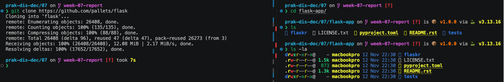

### 4.3 Membuat environment Python 3.14

```bash
cd ~/src/flask-app
uv venv --python 3.14
source .venv/bin/activate
python --version
```

Terbentuk `.venv` berisi CPython 3.14.8. Environment dipisahkan dari Python sistem agar paket Flask tidak mengotori instalasi macOS.

### 4.4 Memasang paket aplikasi

```bash
uv pip install -e .
```

Pemasangan *editable* (`-e`) membuat paket `flaskr` terdaftar di environment sekaligus mengambil dependensinya: `flask` 3.1.3, `werkzeug`, `jinja2`, `click`, `itsdangerous`, `blinker`, dan `markupsafe`.

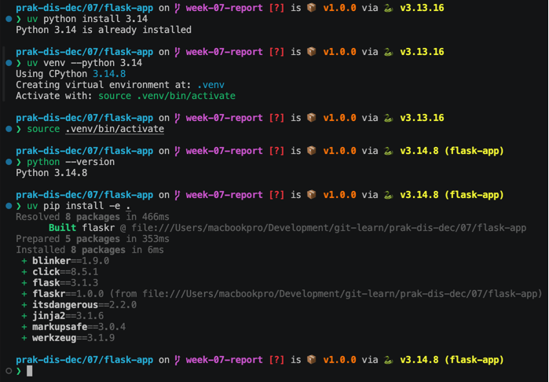

### 4.5 Inisialisasi basis data dan menjalankan aplikasi

```bash
flask --app flaskr init-db
flask --app flaskr run
```

`init-db` menjalankan `schema.sql` sehingga terbentuk `instance/flaskr.sqlite`. Server pengembangan Flask kemudian berjalan di `http://127.0.0.1:5000`.

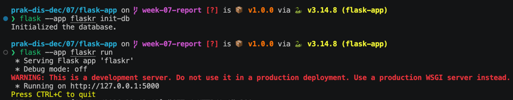

### 4.6 Register dan login

Melalui browser, dipilih **Register**, diisi username dan password, lalu **Log In**. Setelah login, halaman **Posts** muncul dengan tombol **New** untuk membuat tulisan.

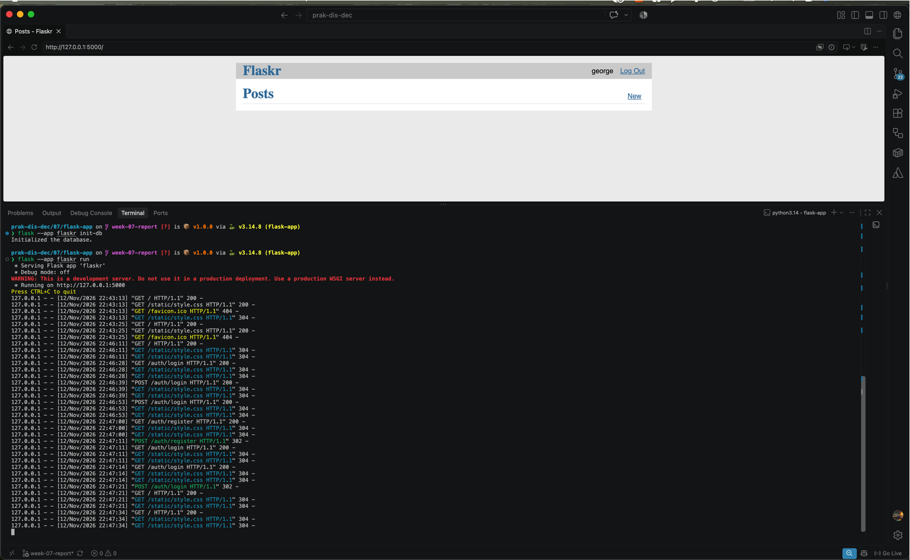

### 4.7 Membuat `Dockerfile`

Berkas diletakkan di root aplikasi, isinya sesuai modul:

```dockerfile
FROM python:3.14

RUN mkdir /app
WORKDIR /app
ADD . /app/
RUN pip install -e .
RUN flask --app flaskr init-db

EXPOSE 5000
CMD ["flask", "--app", "flaskr", "run", "--host=0.0.0.0", "--port=5000"]
```

Ditambahkan satu berkas bantuan `.dockerignore` berisi `.venv/`, `__pycache__/`, `*.pyc`, `instance/`, dan `.pytest_cache/`. Tanpa berkas ini, perintah `ADD . /app/` akan menyalin environment virtual dan basis data lokal ke dalam image sehingga build lambat dan image membengkak.

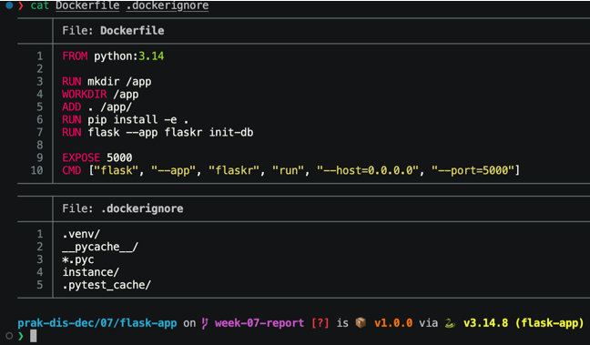

### 4.8 Build image dengan Docker

```bash
docker build -f Dockerfile -t flaskr:1.0.0 .
```

Build context yang terkirim hanya 54,27 KB karena `.dockerignore` bekerja. Semua delapan instruksi berhasil, ditutup dengan `Successfully tagged flaskr:1.0.0`. Build memerlukan waktu sekitar 3 menit 14 detik karena harus menarik base image `python:3.14` lebih dahulu.

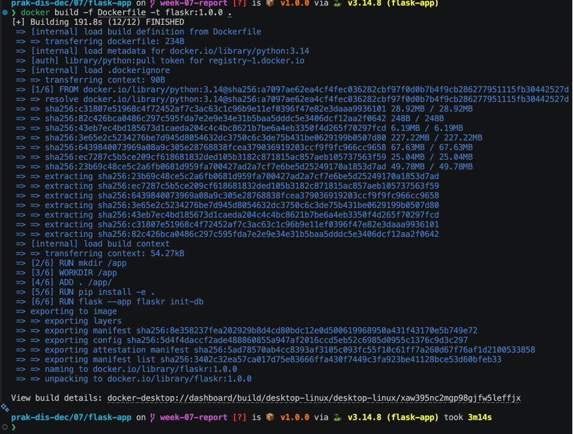

### 4.9 Memeriksa image

```bash
docker images
```

Terdaftar image `flaskr:1.0.0` berukuran 1,64 GB di samping base image `python:3.14` sebesar 1,16 GB. Modul juga menyarankan menghapus image yang tidak terpakai; pada praktik ini tidak ada image sisa, sehingga `docker image prune -f` dijalankan dan melaporkan `Total reclaimed space: 0B`.

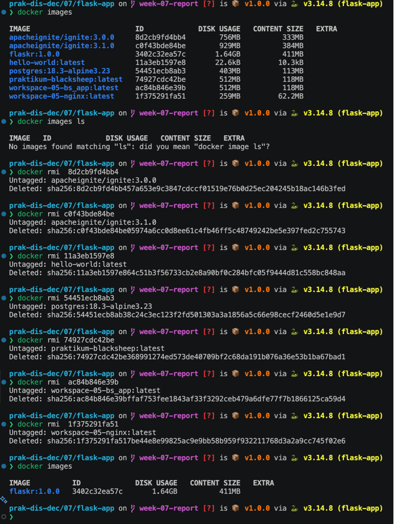

### 4.10 Menjalankan container Docker

```bash
docker run -d --name flaskr-web -p 5001:5000 flaskr:1.0.0
docker ps
open http://localhost:5001
```

Container `flaskr-web` berjalan dengan status `Up` dan pemetaan `0.0.0.0:5001->5000/tcp`. Halaman blog terbuka di `http://localhost:5001`; `curl -I` menjawab `HTTP/1.1 200 OK` dengan header `Server: Werkzeug/3.1.0 Python/3.14.10`, dan log container mencatat permintaan `GET /`, `POST /auth/register`, serta `POST /auth/login`.

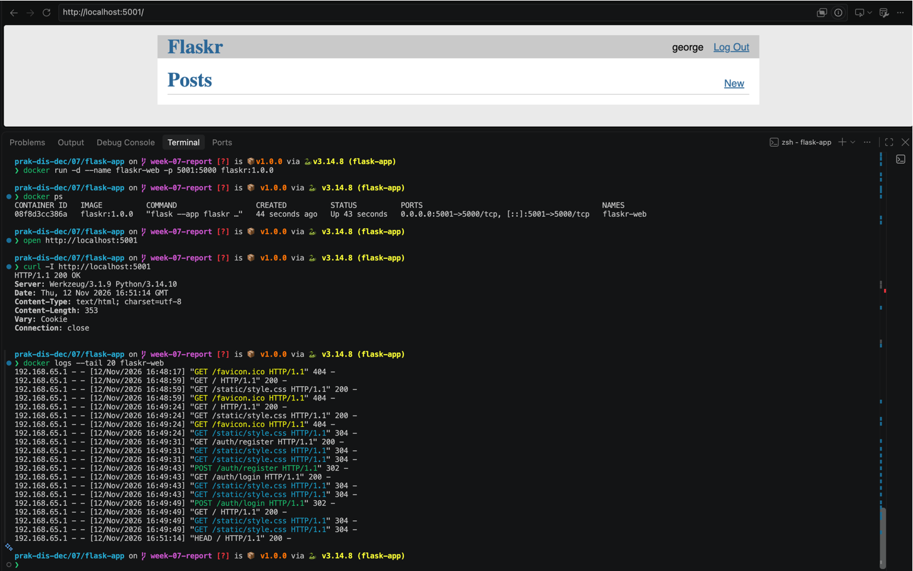

### 4.11 Berpindah ke Podman

```bash
docker stop flaskr-web && docker rm flaskr-web
osascript -e 'quit app "Docker"'
podman machine init
podman machine start
podman machine list
```

Pada Linux, modul mematikan `dockerd` dengan `systemctl stop docker`. Di macOS, layanan yang setara adalah proses Docker Desktop, sehingga aplikasi tersebut dihentikan. Podman memakai mesin virtual sendiri; `podman machine list` menampilkan `podman-machine-default` dengan status `Currently running`, 4 vCPU, dan 2 GiB RAM.

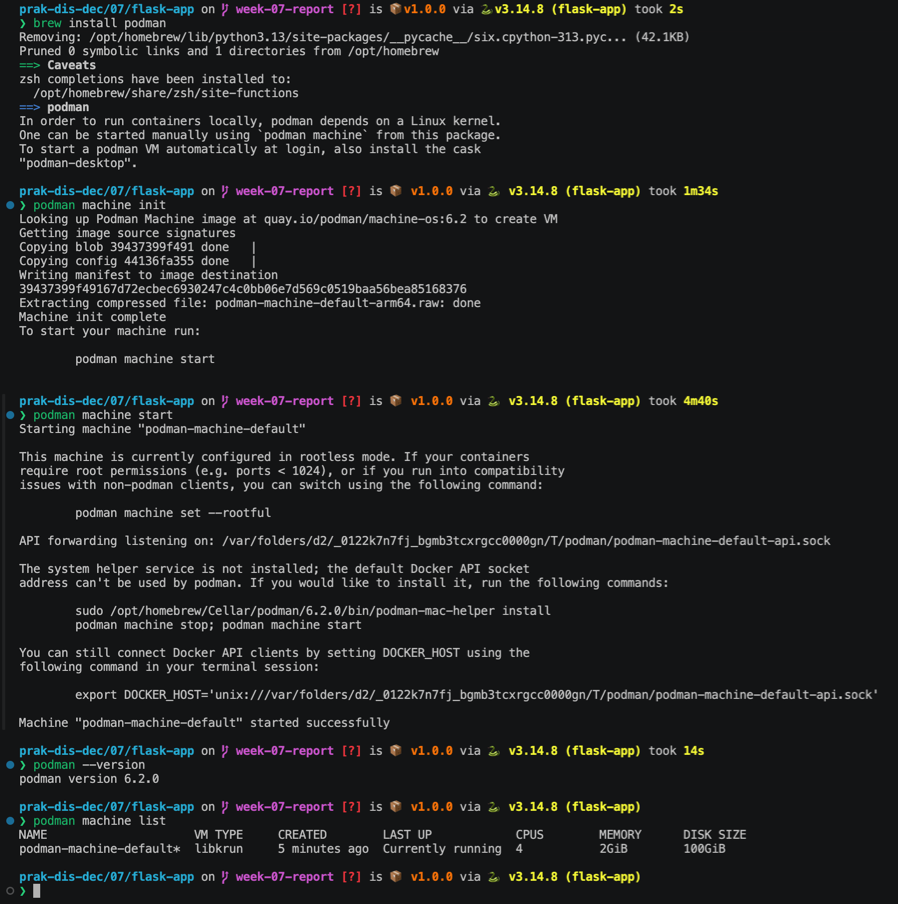

### 4.12 Build image dengan Podman

```bash
podman build -f Dockerfile -t flaskr:1.0.0 .
```

Podman membaca `Dockerfile` yang sama tanpa perubahan. Kedelapan langkah (`STEP 1/8` sampai `STEP 8/8`) berhasil, termasuk `Initialized the database.`, lalu image diberi tag `localhost/flaskr:1.0.0`. Build selesai dalam 1 menit 56 detik.

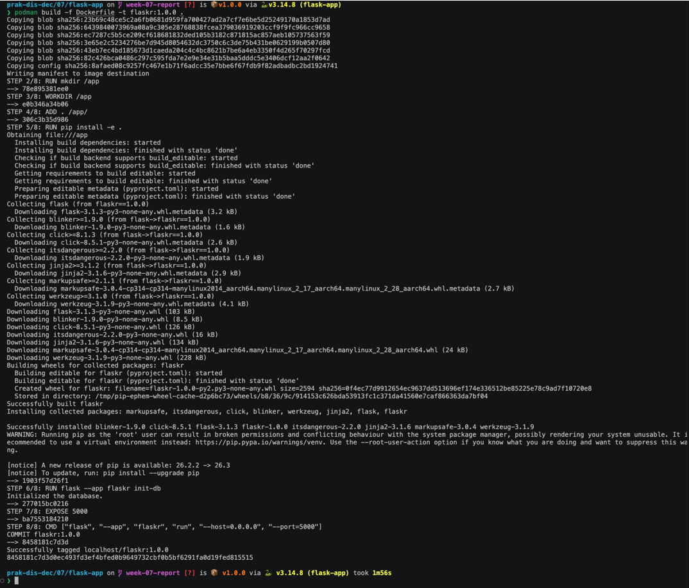

### 4.13 Memeriksa image Podman

```bash
podman images
```

Terdaftar `localhost/flaskr:1.0.0` berukuran 1,17 GB. Perbedaan angka dengan Docker dibahas pada bagian analisis.

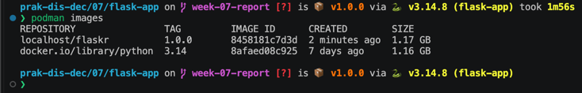

### 4.14 Menjalankan container Podman

```bash
podman run -d --name flaskr-pod -p 5001:5000 flaskr:1.0.0
podman ps
```

Container `flaskr-pod` berjalan dengan pemetaan `0.0.0.0:5001->5000/tcp`.

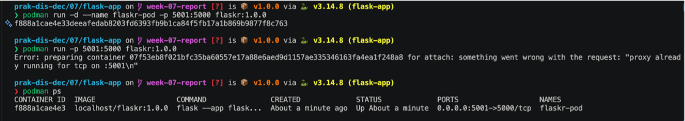

### 4.15 Mengakses aplikasi dari browser

```bash
open http://localhost:5001
```

Halaman **Posts** tampil lengkap dengan data yang dibuat pada langkah 4.6, membuktikan aplikasi berjalan dari image container, bukan dari environment Python lokal.

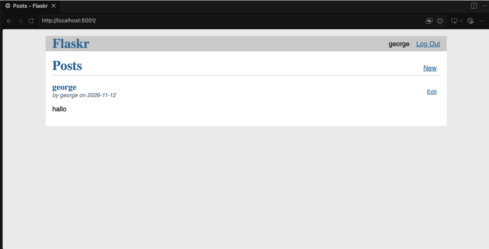

Verifikasi akhir:

```bash
podman ps
curl -I http://localhost:5001
```

`curl` menjawab `HTTP/1.1 200 OK` dan `podman ps` menampilkan container `flaskr-pod` berstatus `Up`.

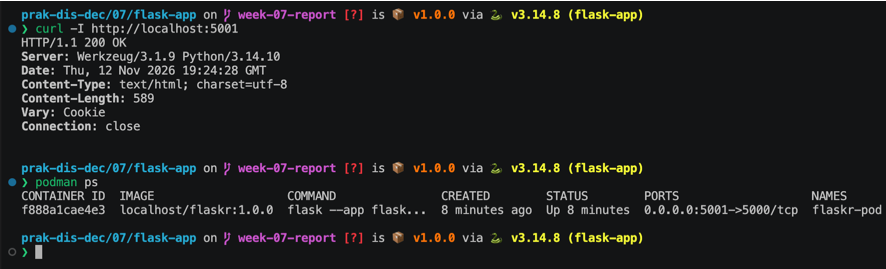

---

## 5. Hasil Praktikum

| Aspek | Docker | Podman |
| --- | --- | --- |
| Container engine | Docker Desktop 29.9.2 (daemon `dockerd` di VM) | Podman 6.2.0 (`podman machine`, libkrun) |
| Layanan latar | Wajib (`dockerd` harus aktif) | Tidak ada; `podman machine` hanya VM-nya |
| Perintah build | `docker build -f Dockerfile -t flaskr:1.0.0 .` | `podman build -f Dockerfile -t flaskr:1.0.0 .` |
| Waktu build | ± 3 menit 14 detik | ± 1 menit 56 detik |
| Ukuran image | 1,64 GB | 1,17 GB |
| Pemetaan port | `-p 5001:5000` | `-p 5001:5000` |
| Nama container | `flaskr-web` | `flaskr-pod` |
| Verifikasi | `HTTP/1.1 200 OK` | `HTTP/1.1 200 OK` |
| Tag image | `flaskr:1.0.0` | `localhost/flaskr:1.0.0` |

Keduanya berhasil menjalankan aplikasi blog yang sama dari satu `Dockerfile` tanpa modifikasi. Image Docker menggunakan namespace default `docker.io`, sedangkan Podman menambahkan awalan `localhost/` karena image dibangun secara lokal.

---

## 6. Analisis

**Container menjawab masalah portabilitas.** Sebelum dibungkus, aplikasi hanya berjalan jika Python 3.14, `uv`, dan paket Flask terpasang di mesin. Setelah menjadi image, seluruh dependensi itu ikut di dalam image, sehingga mesin lain hanya perlu satu perintah `run`. Inilah bentuk paling sederhana dari PaaS yang dibangun sendiri: image berperan sebagai artefak yang dapat dipindahkan antar-node.

**Daemon dan model keamanan.** Docker memerlukan layanan latar yang berjalan sebagai root, sehingga setiap pengguna yang masuk grup `docker` efektif memegang hak root. Podman menghindari hal ini karena container dijalankan sebagai proses anak tanpa daemon. Konsekuensinya, pada Podman tidak ada langkah "menyalakan service" seperti `systemctl start docker`; yang perlu dinyalakan hanya mesin virtual Linux-nya.

**Perbedaan ukuran image bukan perbedaan isi aplikasi.** Kedua image dibangun dari `Dockerfile` yang sama, tetapi Docker melaporkan 1,64 GB dan Podman 1,17 GB. Selisih ini berasal dari cara masing-masing engine menghitung ukuran layer dan base image (Docker ikut menghitung layer hasil build berlapis, sedangkan Podman menampilkan ukuran hasil dekompresi yang dipakai bersama). Yang penting, lapisan aplikasi keduanya identik: `flaskr` 1.0.0 di atas `python:3.14`.

**Build context dan `.dockerignore`.** Perintah `ADD . /app/` menyalin seluruh direktori kerja ke image. Dengan `.venv` di dalamnya, konteks build bisa mencapai ratusan megabyte dan build menjadi lambat; setelah `.dockerignore` ditambahkan, konteks turun menjadi 54,27 KB. Ini menunjukkan bahwa efisiensi image ditentukan juga oleh disiplin menyiapkan konteks, bukan hanya oleh isi `Dockerfile`.

**Data tetap bersifat sementara.** `init-db` dijalankan saat build, sehingga skema basis data sudah ada di dalam image. Namun post yang dibuat pengguna tersimpan di `instance/flaskr.sqlite` di dalam *filesystem container*; ketika container dihapus, data itu hilang. Untuk pemakaian nyata perlu volume terpisah, misalnya `-v flaskr-data:/app/instance`. Prinsip ini sejalan dengan sifat sistem terdistribusi: container dibuat *stateless*, sedangkan keadaan disimpan di luar container agar dapat diganti atau direplikasi kapan saja.

**Container sebagai unit penyebaran.** Karena container membawa runtime-nya sendiri, node tujuan tidak perlu menyamakan versi Python atau pustaka. Ini adalah dasar dari orkestrasi seperti Kubernetes, di mana image yang sama disebar ke banyak node, masing-masing menjalankan salinan container yang identik.

---

## 7. Kendala dan Solusi

| Kendala | Solusi |
| --- | --- |
| Modul meminta Python 3.14.4, sedangkan repositori `uv` hanya menyediakan 3.14.8 | Dipakai 3.14.8; perbedaan patch tidak mempengaruhi hasil, dicatat sebagai deviasi |
| Perintah modul berbasis Linux (`sudo`, `systemctl start/stop docker`, `dinitctl`) tidak berlaku di macOS | Diganti `open -a Docker` untuk menyalakan dan menutup Docker Desktop untuk mematikan; `podman machine init/start` untuk Podman |
| Container Linux tidak dapat berjalan langsung di kernel macOS | Diandalkan VM Linux bawaan Docker Desktop dan `podman machine` |
| Build context membengkak karena `.venv` dan `instance/` ikut tersalin | Ditambahkan `.dockerignore`; konteks build turun menjadi 54,27 KB |
| Aplikasi hanya bisa diakses pada port 5000 di dalam container | Container dijalankan dengan `-p 5001:5000` sesuai modul agar tidak bentrok dengan server Flask lokal |
| Data post hilang ketika container dihapus | Dicatat sebagai keterbatasan; solusinya volume (`-v`) di luar cakupan modul |
| Port 5001 tidak bisa dipakai bersamaan oleh Docker dan Podman | Container Docker dihentikan lebih dahulu sebelum container Podman dijalankan |

---

## 8. Kesimpulan

1. XaaS membagi layanan cloud menjadi IaaS, PaaS, dan SaaS; semakin tinggi lapisannya, semakin sedikit komponen yang dikelola konsumen.
2. Aplikasi Flask `flaskr` berhasil diubah menjadi *containerized app* dengan satu `Dockerfile` berisi delapan instruksi, dan dapat dijalankan oleh dua engine berbeda tanpa perubahan berkas.
3. Docker dan Podman menghasilkan perilaku yang sama pada host macOS: container berjalan di VM Linux internal, port 5001 host dipetakan ke port 5000 container, dan aplikasi dapat diakses dari browser.
4. Perbedaan utama keduanya terletak pada model layanan: Docker membutuhkan daemon, Podman tidak.
5. Container membuat aplikasi portabel, tetapi tidak otomatis persisten; data yang harus bertahan perlu disimpan pada volume di luar container.

---

## 9. Referensi

1. Modul 7 Praktikum Sistem Terdistribusi dan Terdesentralisasi — *Cloud Computing*. Prodi Informatika, Universitas Teknologi Digital Indonesia.
2. Flask Documentation — *Tutorial*. <https://flask.palletsprojects.com/en/stable/tutorial/>
3. Source code tutorial Flask. <https://github.com/pallets/flask/tree/3.1.3/examples/tutorial>
4. Docker Documentation — *Docker overview*. <https://docs.docker.com/get-started/overview/>
5. Podman Documentation. <https://podman.io/docs>
6. Catatan penggunaan `uv`. <https://github.com/NEO-X-School/notes/tree/main/uv>
