# Laporan Praktikum Sistem Terdistribusi dan Terdesentralisasi

## Pertemuan 08 — Arsitektur Microservices untuk Sistem Terdistribusi

### Identitas

- Nama: **Zul Ikhwanul Anggara**
- NIM: **255410043**
- Kelas: **Informatika-1**
- Tanggal praktikum: **19 November 2026**

---

## 1. Tujuan

1. Memahami arsitektur *microservices* sebagai salah satu pola perancangan sistem terdistribusi, khususnya pemisahan frontend (UI/UX) dan backend yang berupa layanan (*service*).
2. Memahami REST API sebagai mekanisme komunikasi antar layanan beserta pemetaan operasi CRUD ke metode HTTP.
3. Mampu membangun layanan backend sederhana menggunakan FastAPI dan SQLModel di atas basis data SQLite.
4. Mampu membuat tabel, mengisi data, dan menampilkan data melalui endpoint RESTful, lalu mengujinya dengan browser dan `curl`.

---

## 2. Dasar Teori

### 2.1 Microservices

Pada arsitektur *microservices*, aplikasi dipecah menjadi kumpulan layanan kecil yang berdiri sendiri. Frontend berisi UI/UX dan menjadi titik interaksi pengguna, sedangkan backend menyediakan *service* yang dipanggil frontend. Setiap layanan memiliki tanggung jawab terbatas, dapat dikembangkan dan di-*deploy* terpisah, serta berkomunikasi melalui kontrak jaringan.

Konsekuensi desainnya: layanan harus punya antarmuka yang jelas (API), tidak boleh bergantung pada keadaan internal layanan lain, dan harus tetap bisa melayani permintaan meskipun layanan lain sedang tidak tersedia. Inilah yang membedakannya dari aplikasi monolitik yang seluruh komponennya berjalan dalam satu proses dan satu basis kode.

### 2.2 REST API

REST (*Representational State Transfer*) memodelkan layanan sebagai kumpulan *resource* yang diakses melalui URL, dengan metode HTTP sebagai kata kerja:

| Metode | Operasi | Contoh pada modul |
| ------ | ------- | ----------------- |
| `GET` | membaca data | `GET /sdm/`, `GET /produk/` |
| `POST` | menambah data | (dikembangkan lanjut) |
| `PUT`/`PATCH` | mengubah data | (dikembangkan lanjut) |
| `DELETE` | menghapus data | (dikembangkan lanjut) |

Representasi data yang dipertukarkan pada praktikum ini adalah JSON, sehingga frontend dari teknologi apa pun dapat mengonsumsi layanan yang sama.

### 2.3 FastAPI, SQLModel, dan SQLite

**FastAPI** adalah *framework* web Python yang membangkitkan dokumentasi OpenAPI otomatis dan memvalidasi *request* maupun *response* berdasarkan *type hint*. **SQLModel** menggabungkan Pydantic dan SQLAlchemy sehingga satu kelas Python berfungsi sekaligus sebagai model tabel dan skema validasi. **SQLite** adalah basis data relasional berbasis berkas tunggal yang tidak memerlukan server terpisah, sehingga cocok untuk praktikum dan prototipe.

Dependency injection FastAPI dipakai untuk menyediakan sesi basis data per *request* melalui fungsi `get_session()` yang menggunakan `yield`, sehingga sesi selalu ditutup setelah permintaan selesai.

---

## 3. Alat dan Bahan

- macOS dengan Python 3.14.4 yang dikelola oleh `uv`
- `uv` (manajemen Python, *virtual environment*, dan paket)
- Paket `fastapi[standard]` dan `sqlmodel`
- SQLite 3.44.4 (`sqlite3` CLI)
- `curl` dan peramban web
- Editor teks / VS Code

---

## 4. Langkah Pengerjaan

### 4.1 Menyiapkan lingkungan Python

Memastikan Python tersedia dan mengunci versi proyek, lalu membuat *virtual environment* dan mengaktifkannya.

```bash
uv python list
uv python pin 3.14.4
uv venv
source .venv/bin/activate
```

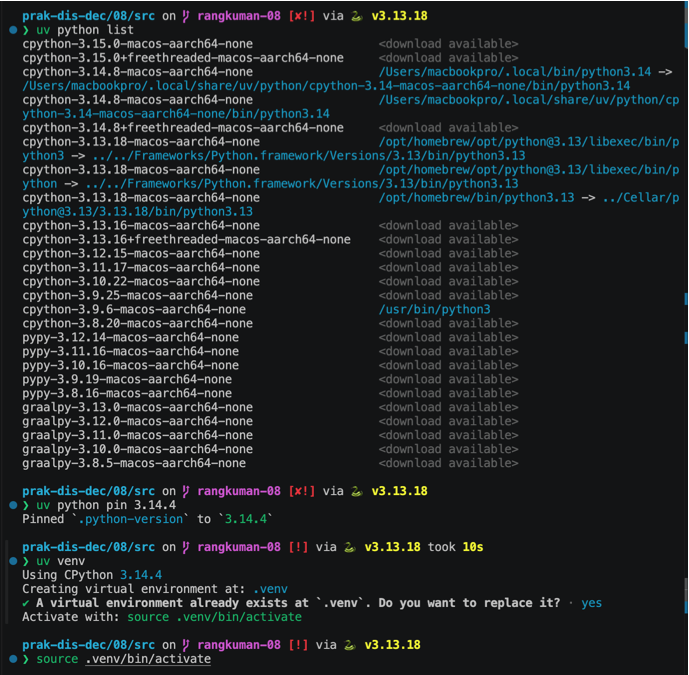

### 4.2 Memasang dependensi

```bash
uv pip install "fastapi[standard]" sqlmodel
```

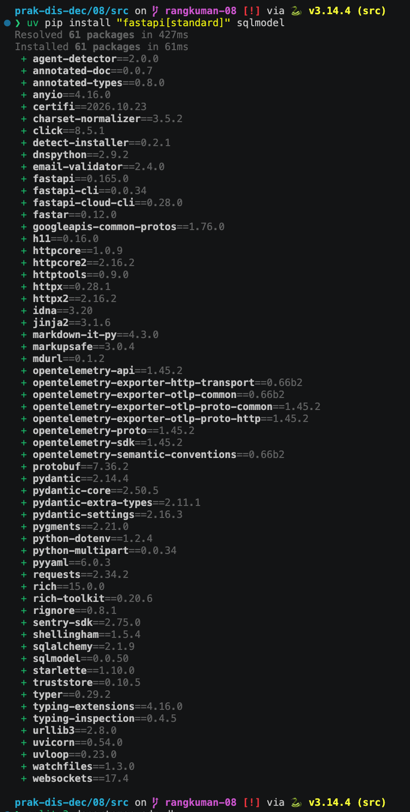

### 4.3 Membuat dan memeriksa basis data contoh

Basis data `departemen-sdm.db` dibuat, lalu tabel `sdm` diisi tiga baris data dan diperiksa langsung dari CLI.

```bash
sqlite3 departemen-sdm.db
```

```sql
SELECT * FROM sdm;
```

Hasil: tiga baris data karyawan (`112233`, `223344`, `334455`).

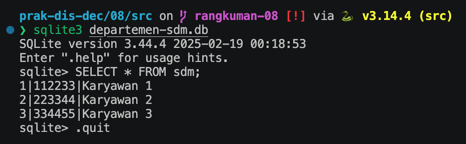

### 4.4 Menulis layanan `service.py`

Model `Sdm` dipetakan ke tabel `sdm`, mesin SQLAlchemy diarahkan ke `sqlite:///departemen-sdm.db`, dan endpoint `GET /sdm/` mengembalikan seluruh baris.

```python
from typing import List, Optional
from fastapi import Depends, FastAPI, HTTPException
from sqlmodel import Field, Session, SQLModel, create_engine, select

class Sdm(SQLModel, table=True):
    id: int | None = Field(default=None, primary_key=True)
    npp: str
    nama: str

engine = create_engine("sqlite:///departemen-sdm.db")

def get_session():
    with Session(engine) as session:
        yield session

app = FastAPI()

@app.get("/sdm/", response_model=List[Sdm])
def read_sdm(session: Session = Depends(get_session)):
    statement = select(Sdm)
    results = session.exec(statement).all()
    return results
```

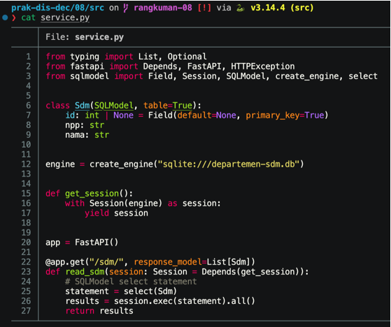

### 4.5 Menjalankan layanan

```bash
python -m uvicorn service:app --reload
```

Server berjalan di `http://127.0.0.1:8000`. Permintaan `GET /sdm/` menghasilkan `200 OK`, sedangkan `/docs` menghasilkan `307 Temporary Redirect` menuju dokumentasi Swagger UI.

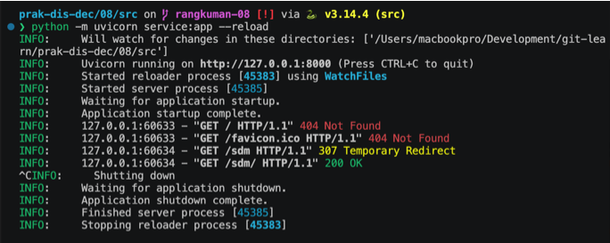

### 4.6 Memeriksa keluaran dari browser

Membuka `http://127.0.0.1:8000/sdm/` menampilkan JSON berisi seluruh data SDM.

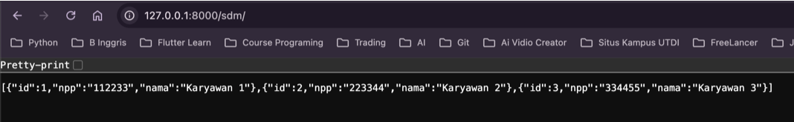

### 4.7 Tugas: membuat tabel baru `produk`

Tabel `produk` dibuat pada basis data terpisah `inventaris.db` dengan satu *primary key* serta tipe data `INT`, `CHAR`, `VARCHAR`, `BOOLEAN`, dan `FLOAT`.

```bash
sqlite3 inventaris.db
```

```sql
CREATE TABLE produk (
    id INTEGER PRIMARY KEY,
    kode_sku CHAR(6),
    nama_produk VARCHAR(100),
    stok INT,
    harga FLOAT,
    tersedia BOOLEAN
);
```

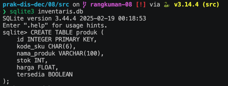

### 4.8 Tugas: mengisi 5 data dengan skrip Python

`set_data.py` mendefinisikan model `Produk` dengan `SQLModel` dan menyisipkan lima baris data melalui `Session`.

```python
from sqlmodel import Field, Session, SQLModel, create_engine

class Produk(SQLModel, table=True):
    id: int | None = Field(default=None, primary_key=True)
    kode_sku: str = Field(max_length=6)
    nama_produk: str = Field(max_length=100)
    stok: int
    harga: float
    tersedia: bool

engine = create_engine("sqlite:///inventaris.db")

def insert_initial_data():
    daftar_produk = [
        Produk(kode_sku="PRD001", nama_produk="Keyboard", stok=15, harga=1250000.0, tersedia=True),
        Produk(kode_sku="PRD002", nama_produk="Mouse Wireless Logitech MX Master 3S", stok=8, harga=1599000.5, tersedia=True),
        Produk(kode_sku="PRD003", nama_produk="USB-C Hub", stok=0, harga=650000.0, tersedia=False),
        Produk(kode_sku="PRD004", nama_produk="Monitor LG UltraGear 24 Inch", stok=5, harga=2350000.75, tersedia=True),
        Produk(kode_sku="PRD005", nama_produk="Laptop Stand Aluminium", stok=20, harga=185000.0, tersedia=True),
    ]

    with Session(engine) as session:
        for item in daftar_produk:
            session.add(item)
        session.commit()
        print("Berhasil memasukkan 5 data produk ke database inventaris.db!")

if __name__ == "__main__":
    insert_initial_data()
```

Menjalankan skrip lalu memeriksa isi tabel:

```bash
python set_data.py
sqlite3 inventaris.db "SELECT * FROM produk;"
```

Keluaran: lima baris `PRD001`–`PRD005`, dengan kolom `tersedia` tersimpan sebagai `1`/`0`.

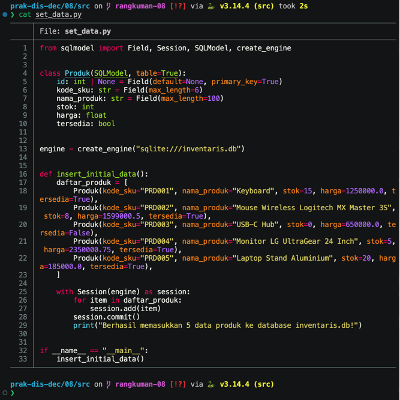

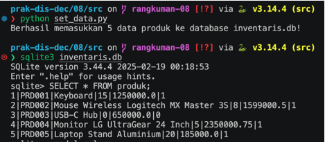

### 4.9 Tugas: endpoint RESTful untuk `produk`

`tugas_service.py` memakai model dan basis data yang sama, lalu mengekspos `GET /produk/`.

```python
from typing import List
from fastapi import Depends, FastAPI
from sqlmodel import Field, Session, SQLModel, create_engine, select

class Produk(SQLModel, table=True):
    id: int | None = Field(default=None, primary_key=True)
    kode_sku: str = Field(max_length=6)
    nama_produk: str = Field(max_length=100)
    stok: int
    harga: float
    tersedia: bool

engine = create_engine("sqlite:///inventaris.db")

def get_session():
    with Session(engine) as session:
        yield session

app = FastAPI(title="Microservice Inventaris Produk")

@app.get("/produk/", response_model=List[Produk])
def read_produk(session: Session = Depends(get_session)):
    statement = select(Produk)
    results = session.exec(statement).all()
    return results
```

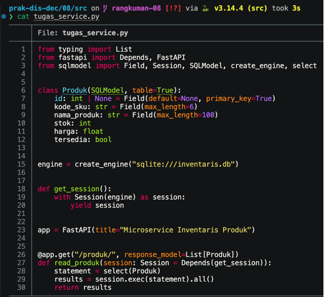

### 4.10 Tugas: menguji endpoint dengan `curl`

```bash
python -m uvicorn tugas_service:app --reload
curl http://127.0.0.1:8000/produk/
```

Server mencatat `GET /produk/ HTTP/1.1 200 OK`, dan `curl` menerima JSON berisi kelima produk beserta atribut `id`, `kode_sku`, `nama_produk`, `stok`, `harga`, dan `tersedia`.

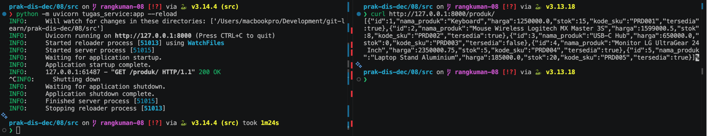

---

## 5. Hasil Praktikum

1. Lingkungan Python 3.14.4 berhasil disiapkan dengan `uv` dan seluruh dependensi terpasang di dalam `.venv`.
2. Layanan contoh berjalan dan `GET /sdm/` mengembalikan:

   ```json
   [{"id":1,"npp":"112233","nama":"Karyawan 1"},
    {"id":2,"npp":"223344","nama":"Karyawan 2"},
    {"id":3,"npp":"334455","nama":"Karyawan 3"}]
   ```

3. Tabel `produk` berhasil dibuat dengan tipe data yang diminta, dan lima data terisi melalui skrip Python.
4. Endpoint `GET /produk/` mengembalikan seluruh data produk dalam bentuk JSON, terbukti dari status `200 OK` dan keluaran `curl`:

   ```json
   [{"id":1,"kode_sku":"PRD001","nama_produk":"Keyboard","stok":15,"harga":1250000.0,"tersedia":true},
    {"id":2,"kode_sku":"PRD002","nama_produk":"Mouse Wireless Logitech MX Master 3S","stok":8,"harga":1599000.5,"tersedia":true},
    {"id":3,"kode_sku":"PRD003","nama_produk":"USB-C Hub","stok":0,"harga":650000.0,"tersedia":false},
    {"id":4,"kode_sku":"PRD004","nama_produk":"Monitor LG UltraGear 24 Inch","stok":5,"harga":2350000.75,"tersedia":true},
    {"id":5,"kode_sku":"PRD005","nama_produk":"Laptop Stand Aluminium","stok":20,"harga":185000.0,"tersedia":true}]
   ```

Seluruh bukti pengerjaan dilampirkan pada bagian 4 (gambar 01–11).

---

## 6. Analisis

Praktikum ini memperlihatkan bentuk paling sederhana dari layanan pada sistem terdistribusi: satu proses HTTP yang membungkus satu sumber data. Batas layanan terlihat jelas — konsumen hanya mengenal URL dan bentuk JSON, bukan skema tabel atau bahasa pemrograman backend. Karena kontraknya berupa HTTP + JSON, layanan `sdm` dan `produk` dapat digabungkan oleh satu frontend, diganti implementasinya, atau dipindahkan ke mesin lain tanpa mengubah pemanggil.

Pemisahan basis data per layanan (`departemen-sdm.db` dan `inventaris.db`) mencerminkan prinsip *database per service*: tidak ada layanan yang membaca tabel milik layanan lain. Konsekuensinya, konsistensi antar layanan tidak lagi gratis seperti pada satu basis data monolitik, sehingga kebutuhan transaksi lintas layanan harus diselesaikan di level aplikasi (misalnya *saga* atau kompensasi).

Beberapa hal teknis yang teramati:

- `response_model=List[Sdm]` membuat FastAPI memvalidasi dan memfilter keluaran, sehingga hanya kolom yang dideklarasikan yang dikirim ke klien.
- `Depends(get_session)` menjamin satu sesi per permintaan dan menutupnya kembali, menghindari kebocoran koneksi saat layanan menerima banyak permintaan bersamaan.
- Basis data SQLite mudah dipakai, tetapi menulis dengan cara mengunci seluruh berkas. Pada layanan yang benar-benar terdistribusi dan menerima banyak penulisan bersamaan, SQLite perlu diganti dengan basis data klien-server (PostgreSQL/MySQL) tanpa mengubah kontrak API.
- Endpoint masih bersifat *read-only*. Operasi tulis (`POST`, `PUT`, `DELETE`) belum ada, sehingga layanan belum lengkap sebagai CRUD dan belum memiliki validasi masukan dari klien.

---

## 7. Kendala dan Solusi

| Kendala | Solusi |
| ------- | ------ |
| `uv venv` menanyakan penggantian `.venv` yang sudah ada | Konfirmasi `yes`; lingkungan lama tidak diperlukan lagi |
| Perintah `python`/`uvicorn` tidak dikenali | Pastikan `.venv` aktif dengan `source .venv/bin/activate` |
| Mengakses `http://127.0.0.1:8000/` menghasilkan `404 Not Found` | Root tidak didefinisikan; akses path yang tersedia (`/sdm/`, `/produk/`) atau `/docs` |
| `/docs` mengembalikan `307 Temporary Redirect` | Perilaku normal; ikuti *redirect* ke `/docs/` |
| Tabel `produk` gagal dibuat karena sudah ada | Hapus `inventaris.db` atau gunakan `CREATE TABLE IF NOT EXISTS` |
| Skrip pengisian dijalankan dua kali sehingga data ganda | Hapus berkas basis data lalu jalankan ulang skrip, atau tambahkan pengecekan data sebelum *commit* |
| Kolom `tersedia` tampil `1`/`0` di SQLite | SQLite tidak punya tipe boolean asli; `SQLModel` memetakannya kembali menjadi `true`/`false` pada JSON |

---

## 8. Kesimpulan

1. Arsitektur *microservices* dapat dimulai dari satu layanan REST sederhana: frontend berkomunikasi dengan backend hanya melalui kontrak HTTP dan JSON.
2. FastAPI dan SQLModel memungkinkan pembuatan layanan basis data dengan kode minimal — satu kelas Python berperan sebagai model tabel sekaligus skema validasi respons.
3. Tugas berhasil diselesaikan: tabel `produk` dibuat dengan tipe `INT`, `CHAR`, `VARCHAR`, `BOOLEAN`, dan `FLOAT`; lima data diisikan melalui skrip Python; endpoint `GET /produk/` mengembalikan seluruh data dan terverifikasi melalui `curl` dengan status `200 OK`.
4. Untuk pengembangan lanjutan, layanan perlu dilengkapi operasi tulis, validasi masukan, penanganan galat, autentikasi, serta basis data klien-server agar layak digunakan pada sistem terdistribusi berskala nyata.

---

## 9. Referensi

1. Modul 8 — *Arsitektur Microservices untuk Sistem Terdistribusi*, Praktikum Sistem Terdistribusi dan Terdesentralisasi, Prodi Informatika, Universitas Teknologi Digital Indonesia. Penulis: Dr. Bambang Purnomosidi D. P.
2. Dokumentasi resmi FastAPI — <https://fastapi.tiangolo.com/>
3. Dokumentasi resmi SQLModel — <https://sqlmodel.tiangolo.com/>
4. Dokumentasi resmi SQLite — <https://www.sqlite.org/docs.html>
5. Dokumentasi `uv` — <https://docs.astral.sh/uv/>
